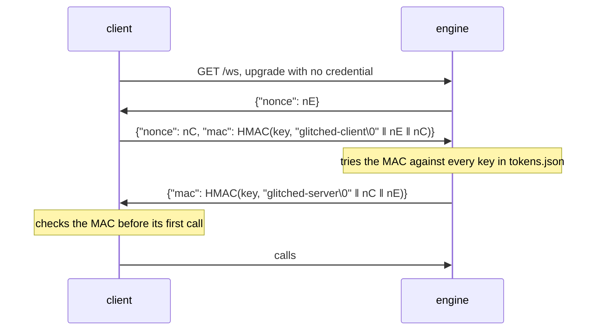

# Network: Tailscale first

Decided 2026-10-22. This replaces the relay, the LAN, SSH and the relay routes in `architecture.md`, and the Durable Object relay in `hub-on-cloudflare.md`.

## Decision

**Every node and client is on the user's tailnet. There is no Glitched relay.**

- **Tailscale installed:** Glitched uses it through its local API (`tailscale.com/client/local`). It reads its tailnet address and peers, listens on the tailnet address, and identifies callers with `WhoIs`. That gives no second device and no extra login.
- **Tailscale not installed:** the app runs its own node with `tsnet` and becomes a device on the tailnet. The GUI shows "Sign in to Tailscale" using the login URL tsnet reports. This node is in userspace, needs no root, and adds no network interface to the machine.
- **If Tailscale is installed later,** the embedded node logs out on the next start so the machine isn't listed twice.
- Tailscale's DERP servers carry traffic when two devices can't connect directly. DERP runs over HTTPS on 443, so it also gets through networks that block UDP. That is why no Glitched relay is needed.

```go
type Transport interface {
	Listen(ctx context.Context) (net.Listener, error)
	Dial(ctx context.Context, machine ID) (net.Conn, error)
	WhoIs(conn net.Conn) (Peer, error)
}
```

There are two implementations, one for an installed Tailscale and one for the embedded `tsnet` node. A loopback version exists for tests and development.

## Rules

- **Being on the tailnet is the route, not the authorization.** A tailnet can include devices shared by other people. A caller must also present an enrolled Glitched machine key or a client grant, and `WhoIs` is checked against it.
- **Discovery goes through the hub.** Personal devices aren't tagged, so they can't be found by tag. Each node reports its tailnet address to the hub, and the hub returns the machine list. Probing a fixed port on peers is a fallback.
- **Machines join untagged under the user's login.** Untagged devices are unlimited on the free Personal plan. Tags are for VMs only, which are deferred (`ephemeral-vms.md`).
- **Phones and other GUI-only devices are clients, not nodes.** They reach nodes through the Tailscale app. Without it, the app embeds libtailscale in userspace. That uses no VPN slot, which matters on iOS, where only one VPN can run at a time.
- **A browser client is out of scope.** A web page can't run tsnet, and that is the one case that would bring a relay back.

## Built so far (2026-10-22)

`-listen` assumes Tailscale is installed and up. `-tailnet` works either way, as below.

- `glitched serve -listen <addr>` adds a TCP listener beside the unix socket, and may be repeated. The address must be loopback, in `100.64.0.0/10`, or in `fd7a:115c:a1e0::/48` outside the 4via6 range `fd7a:115c:a1e0:b1a::/64`. The engine refuses any other at start, `0.0.0.0` included, because only WireGuard encrypts the traffic. An address in those ranges that the machine doesn't hold yet, as at boot before Tailscale is up, doesn't stop the engine. That listener retries in the background, backing off to 30 seconds, until it binds.
- A client refuses a server name that resolves outside those ranges before it sends anything. In range is not enough. On Linux, Tailscale routes only its current peers, and any other 100.x address leaves by the default route in cleartext. `100.64.0.0/10` is also carrier-grade NAT space, so an ISP can give a machine without Tailscale such an address. So a connection that isn't loopback at both ends must leave from an address on Tailscale's interface. That is the interface that also holds an address in `fd7a:115c:a1e0::/48`, which Tailscale gives every node and a carrier-grade NAT link doesn't have. The client checks the route with a UDP connect, which sends nothing, before it dials, and checks the connection's own addresses after. A server applies the same rule to each connection it accepts, and `pair` suggests only an address on that interface. The interface table is read at most once a second, in one netlink dump on Linux, so a flood of connections can't make each one rescan it.
- These route checks are defense in depth, not the authentication. They don't prove where a connection goes. On Linux, a socket whose source is Tailscale's address still leaves by another interface when the routing table sends it there. The handshake below is what keeps the token safe on such a route.
- A 4via6 address is refused although it is inside `fd7a:115c:a1e0::/48`. Its subnet router forwards the traffic to its LAN as plain IPv4, outside WireGuard.
- Tailscale must run in kernel mode, with its own interface. In userspace-networking mode it has none, so remote access is refused. A kernel with IPv6 disabled likely leaves Tailscale's interface without its `fd7a:` address and is refused too. That case wasn't tested.
- No secret crosses the wire. On every TCP socket the client and the engine prove to each other that they hold the token's key, as the handshake below shows. A wrong or revoked token closes the socket with code 1008. The client reports that the server refused the handshake, not that the token is wrong, because a server that isn't the paired engine can send 1008 too. The unix socket skips the handshake. Its mode is 0600, in a 0700 directory.
- `glitched pair -name <label>` mints a random 32-byte token and prints it once with a connect line. `<dir>/tokens.json` keeps the token's SHA-256, its label and when it was made, with mode 0600. The token itself is never stored. But the hash is the key the handshake proves, so the file is as secret as the tokens. Whoever reads it can connect, or pass for this engine to its clients. `pair -list` lists the labels, and `pair -revoke <label>` removes one.
- The engine rereads `tokens.json` on every handshake and once a second. One lock spans each read and the admission it decides, so no handshake that begins after a revoke returns gets in with the revoked token. The revoke also closes the token's live sockets within a second, without a restart. An unreadable `tokens.json` admits no token and is logged once per distinct error.
- Until a connection is a WebSocket, a server gives each request 10 seconds to arrive, body included, and each response 10 seconds to be written. It closes the connection after 10 idle seconds between requests. So a peer can't hold a connection open by promising a body it never sends, or by never reading the responses. Once the connection is a WebSocket, the client has 5 seconds to prove its key, and the server reads no message over 1 KiB until it has. The engine logs a refused peer at most once a minute.
- `run`, `threads` and `replica` reach a remote engine with `-server <addr> -token <token>`. A host that doesn't run the hub uploads to one with `serve -hub=false -hub-server <addr> -hub-token <token>`. A token without its server, a server without its token, or `-hub` with another hub named exits 2 before anything dials.
- When the hub was unreachable at start, the startup check can't see a restore from backup. If the uploader later finds that the hub holds more of the log than the database, the engine stops with that error and says to restart. `serve` exits 1, and the restart's startup check starts a new log.
- `glitched status` says whether an engine answers the socket under `-dir`, which hub it uses, how the machine is on the tailnet, where the engine serves it, whether each `-listen` address accepts a TCP connection, and the token labels. The GUI's Settings › This machine page reads the same status every 2 seconds while it shows. It also says whether the engine runs inside the app or in another process, such as `glitched serve`. The page turns serving on the tailnet on or off, picks the embedded node's control server, and saves both in `engine.json`. An engine embedded in the app restarts to apply a change. One that `glitched serve` runs applies it on its next start. The page also pairs and revokes tokens as `pair` does, and shows a new token once.
- `serve -tailnet` serves clients with a token on the tailnet at port 7465 (2026-10-26). When Tailscale is installed, the engine reads it through its local API (`tailscale.com/client/local`), waits until it runs, and listens on its address. This Mac's standalone build (`io.tailscale.ipn.macsys`) answered, the risk below. When Tailscale isn't installed, the engine runs its own `tsnet` node, with its identity in `<dir>/tailscale`. Until the node is signed in, the engine's status carries the login URL, which `status` prints and the GUI offers as Sign in. `-control <url>` signs the node in to another control server, such as Headscale's. When Tailscale is installed later, the next start signs that node out and removes it, so the tailnet doesn't list the machine twice.
- The engine decides once, at start, whether Tailscale is installed (2026-10-29). It asks the local API with a 1 second deadline. A Tailscale that answers, or that misses the deadline, counts as installed. A missing socket fails at once and counts as not installed, so a machine without Tailscale takes the embedded path every time. The engine dials tailscaled's socket itself, because `safesocket.ConnectContext` retries a missing one for the first 2 seconds of the process, which made the first probe time out. A tailscaled that hasn't made its socket yet when the engine starts, as during a restart, reads as missing. The engine then runs its own node, and the next start signs it out as above.
- A hub on a loopback IP, such as `-hub-server 127.0.0.1:7465`, is on this machine, so the engine dials it directly and runs no node for it. A hostname such as `localhost` takes the tailnet path.
- The engine's `info` reply carries how its machine is on the tailnet: installed or embedded, the backend state, the MagicDNS name and address, the tailnet and user, the login URL, the control server, and where the engine serves. Protocol 3 added it, in an optional field.
- A connection to the embedded node needs no route check. The node carries every byte inside WireGuard in the process, and `WhoIs` asks the node which peer holds the remote address. The token's handshake still authorizes.
- While the GUI's own engine runs an embedded node, the GUI reaches servers through it. An engine another process runs keeps its node to itself, so a GUI attached to one reaches servers only through an installed Tailscale.
- `internal/daemon` holds the startup that `serve` runs and the GUI will embed. `daemon.Start` takes the lock, opens the store, the runtime and the hub, and binds every socket whose address the machine holds.

### Handshake



The key is the SHA-256 of the pairing token, and the MAC is HMAC-SHA256. Each nonce is 32 random bytes. A client MAC that matches no key closes the socket with code 1008, policy violation, and the client reports `ErrRefused`. That error says the server holds no key for the token or isn't the paired engine. It doesn't say the token is wrong, because any server can send 1008. The engine drops the socket as soon as it has sent 1008. It doesn't wait for the client's close frame. A server MAC that doesn't match makes the client close the socket and report `ErrNotTheServer`, because the address may not be the paired engine. The two labels keep one side's MAC from passing as the other's. Each side gives the other 5 seconds. An admitted socket stays bound to its token's grant, so a revoke still closes it. The package comment in `internal/transport/wire.go` gives the messages.

A misrouted connection exposes little. Suppose a client's connection reaches a listener that isn't the engine, as when Linux sends it out of the wrong interface. That listener learns that a client tried. It sees the upgrade, the client's nonce, and one MAC over the listener's own nonce. That MAC is of no use anywhere else, because the engine picks a new nonce for every socket. It also doesn't reveal the key, which comes from 32 random bytes. The listener gets no call, because the client sends none before the server's MAC checks out.

One case remains open. A party on the wrong route that can also reach the engine over the tailnet can relay the handshake between the two. It can then read and change the calls that follow, because the handshake proves who holds the key but doesn't protect the calls. On a correct route WireGuard protects them, so the route checks stay.

Deferred:

- Checking `WhoIs` against an enrolled machine key. Until then any tailnet peer with a token gets in.
- Asking Tailscale's LocalAPI whether the remote address belongs to a peer in the netmap. The interface rule shows only that a connection's source address is on Tailscale's interface. It doesn't prove that the packets leave through that interface, or which node receives them.
- Protecting the calls themselves, which would close the relay case above. A session key derived from the key and both nonces could sign or encrypt each message.
- Scoped grants. A token reaches the whole engine, the hub included.
- Passing the token some other way than argv.

## Spike (2026-10-21, `/tmp/tsspike`, not in the repo)

Two tsnet nodes in one Go process ran against a local Headscale v0.29.5, using `tailscale.com` v1.104.2.

| | Result |
|---|---|
| Finding the peer | Node B found `glitched-a` from `LocalClient().Status()` by tag. No meeting-point service was involved. |
| Caller identity | `WhoIs` on the accepted connection returned `glitched-b tags=[tag:glitched]`. |
| Path | direct over the LAN, with home DERP `jnb` as the fallback |
| First reply | 52–235 ms, including the WireGuard handshake |
| Cold start | about 5 s for both nodes, including registration |
| Warm start, persistent node | 1.9–3.8 s, with a stable IP |
| Ephemeral node | Headscale deleted it on logout. It gets a new IP every run. |
| Binary | 30 MB for the spike. The size added to Glitched wasn't measured. |

## Tailscale plan limits (pricing page and FAQ, read 2026-10-21)

- Personal is free and covers 6 users and unlimited user devices.
- Tagged resources are limited to 50, and each one beyond that costs $1 a month.
- Ephemeral devices draw on a pool of 1,000 minutes a month. One present for more than 4 hours counts as a tagged resource instead.
- Personal is "only suitable for non-commercial use". Users bring their own tailnet, so Glitched doesn't resell Tailscale.

## Risks

- **The local API on macOS.** The App Store, standalone and open-source builds of Tailscale expose the local API differently, and some only allow the same user. This Mac runs the standalone build (`io.tailscale.ipn.macsys`). A spike must confirm detection here before we depend on it.
- **Tailscale's login is required.** A user who won't sign in to Tailscale can't use more than one machine. That is accepted.
