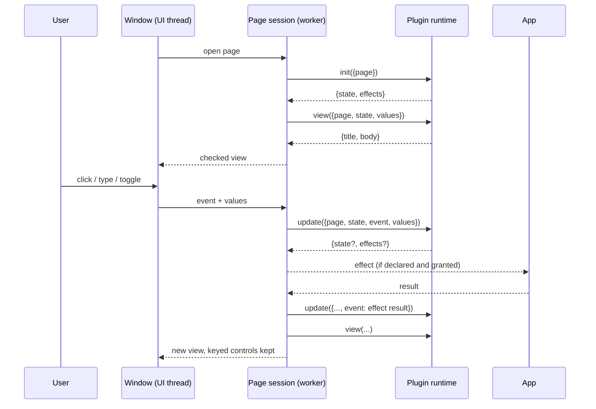

# Plugins

A Glitched plugin is a folder with a `plugin.json` and one JavaScript or TypeScript module. Glitched runs the module with [mygo-plugin](https://github.com/yxxbc/mygo-plugin), in a runtime of its own. A plugin adds pages to the sidebar and commands to the command palette. A page is a tree of native widgets that the plugin describes as data. The app draws it with its own components. The plugin reaches the rest of the app only through effects. The host checks each effect against the capabilities that the plugin declares and that the user grants.

You need no Go and no build step. Copy a folder, reload, and the plugin runs.

Versions:

| What | Version |
| --- | --- |
| App contract (`contract`, `contractVersion` in `plugin.json`) | `glitched` 1 |
| Widget tree (`internal/plugins/widget.Version`) | 1 |
| Runtime | mygo-plugin, pinned in `go.mod` (unreleased `main` at `4cef697`, a pseudo-version) |

A plugin that names another contract, or a newer `contractVersion`, does not load. A plugin that names no contract loads.

## Install and develop

Glitched reads `~/.glitched/plugins` (`$GLITCHED_DIR/plugins`), one folder per plugin, when it starts and when you press **Reload** in **Settings › Plugins**. Each plugin keeps its storage in `~/.glitched/plugin-data/<id>`. Your choices (which plugins are off, what they are granted) go to `~/.glitched/plugins.json`.

```sh
mkdir -p ~/.glitched/plugins
cp -R examples/plugins/snippets ~/.glitched/plugins/
# Open Glitched: Snippets is in the sidebar, above Settings.
```

The loop while you write a plugin:

1. Edit the module in its plugins folder, or link the folder there: `ln -s ~/src/my-plugin ~/.glitched/plugins/my-plugin`.
2. Press **Reload** in **Settings › Plugins**. A reload closes every plugin and opens it again, so its pages start over from `init`.
3. A plugin that does not load shows why under its name in **Settings › Plugins**. A page whose `init`, `view` or `update` fails shows the error above the page, with **Start over**.

Optionally, mygo-plugin's CLI checks a manifest and compiles a module without the app: `go run github.com/yxxbc/mygo-plugin/cmd/mygo-plugin@<version> check ./my-plugin`. Pick `<version>` from `go.mod`.

`examples/plugins/glitched.d.ts` types the contract. In a TypeScript plugin, reference it with `/// <reference path="./glitched.d.ts" />` (copy it next to your module). `main` ending in `.ts` compiles as TypeScript. The module is one file: `import` is not available, so bundle first if you need several.

Samples in `examples/plugins`:

- `hello`: a stock mygo-plugin page (sections and items), no native view.
- `counter`: TypeScript. A counter, an input, a toggle and a section that shows on a condition.
- `snippets`: saved prompts. A form, persistent data, a list, effects, the denial path, two commands, and grants.

## plugin.json

```json
{
  "id": "snippets",
  "name": "Snippets",
  "version": "0.1.0",
  "main": "index.js",
  "contract": "glitched",
  "contractVersion": 1,
  "capabilities": ["composer", "threads:read"],
  "permissions": { "network": ["api.example.com"] },
  "contributes": {
    "pages": [{ "id": "home", "title": "Snippets", "icon": "list" }],
    "commands": [{ "id": "new", "title": "New snippet" }]
  }
}
```

- `id` names the plugin's storage and grants. Two folders with one id: the second does not load.
- `capabilities` lists what the plugin uses of the app (see [Effects](#effects-and-capabilities)). An unknown name stops the plugin from loading.
- `permissions.network` lists the hosts `fetch` may reach. They also need the `network` grant (see [Permissions](#permissions)).
- `contributes.pages` become sidebar entries. A page's `id` is 1 to 64 letters, digits or `_.-`, not starting with a dot; a page with another id is left out. `icon` is one of `sparkles`, `code`, `globe`, `terminal`, `file`, `note`, `inbox`, `clock`, `list`, `settings`, `zap`, `folder`, `message`. Another name shows a plug.
- `contributes.commands` become command palette entries, named `<plugin name>: <title>`.

mygo-plugin reads the other fields (`minAppVersion`, `settings`, `navigation`). Glitched does not show `settings` yet.

## How a page runs



A plugin whose module exports `view` draws its pages as native views. A plugin without `view` but with `page` (or `browse`) draws mygo-plugin's stock pages, as `hello` does.

One session per page holds the page's state. It lives while the app runs and the plugin stays loaded. Leaving the page and coming back keeps it. A reload, disabling the plugin, or **Start over** ends it. What an ended page, or an earlier start of it, asked for is dropped. An effect that waits when its grant is taken back, or its plugin stops, does not run.

The window never waits for the plugin. One worker goroutine per page calls the plugin, one call at a time and in event order. While it works, the window keeps drawing the last view, with a spinner in the page's header.

### Exports

| Export | Called with | Answers | When |
| --- | --- | --- | --- |
| `init` (optional) | `{page}` | `{state?, effects?}` | The page opens, or starts over. Without it, the state is `null`. |
| `view` | `{page, state, values}` | `{title?, subtitle?, body}` | After `init`, and once after each batch of events. |
| `update` | `{page, state, event, values}` | `{state?, effects?}`, or nothing | For each event. Leave `state` out to keep the state. |
| `command` | `{id, args}` | `{effects?}` | A palette command runs. |
| `page` | `{id}` | mygo-plugin's `Page` | Stock pages only. |

Each export may be `async`: the host awaits its promise.

`state` is any JSON value, at most 1 MiB. It goes back to the plugin on every call, so the plugin can stay stateless between calls. A runtime that is restarted (after a timeout, or an overrun of its memory) loses its module's globals but not the page's state. For data that outlasts the app, use `host.storage` (a JSON key-value store in the plugin's data folder).

An answer with a field other than `state` and `effects` is an error.

### Events

A UI event:

```js
{ kind: "ui", type: "click" | "change" | "submit", handler: "save", node: "save", value: "text or true", payload: {...} }
```

- `handler` and `payload` are what the widget's `onClick`, `onChange` or `onSubmit` named. A handler is a name, or `{handler, payload}` with a JSON payload of at most 4 KiB. No function crosses into the app.
- `node` is the widget's `id`.
- `value` is an input's text, a toggle's `true` or `false`, or a select's value.

`values` maps every input, toggle and select of the view, by `id`, to what it held when the event happened, even when the plugin takes the event later. A form therefore needs no `onChange`. Read the fields in the Save button's `update`, as `snippets` does.

While a `change` event waits last in line, a later `change` of the same widget replaces it. A plugin that is behind sees the latest text, not every keystroke. A change never replaces one from before a click or a submit, so a Save sees the text it was pressed with. At most 64 events wait. Past that, the page drops the event and says so.

An effect's answer:

```js
{ kind: "effect", id: "run", effect: "threads.create", ok: true, result: {...} }
{ kind: "effect", id: "run", effect: "threads.create", ok: false, error: "permission denied: ...", denied: true }
```

An effect with an `id` always answers. An effect without one answers only when it fails.

### Keyed widgets and what the user typed

Inputs, toggles and selects keep their value in the app, by their `id`, across views:

- A new widget starts with the `value` its view gives.
- A later view changes it only when its `value` differs from the one the last view gave. So a plugin that leaves `value` out, or keeps it the same, never takes back what the user typed.
- A view that echoes a change the user sent is not a change. A plugin that sets `value` from `onChange` (a controlled input, as in `counter`) does not lose keystrokes made while it answered.
- A controlled widget whose changes the plugin has all taken shows the view's `value` whenever it differs from what the widget holds. So clearing it in the same `update` as a submit works even when the plugin took the typing and the submit in one batch.
- To clear a controlled input, set its `value` to `""` in the state. To reset an uncontrolled one, give it a new `id`, or leave it out of one view.
- A widget that a view leaves out loses its value. Focus and scroll stay with a widget while its `id` stays.

Widgets without an `id` are keyed by their place among their siblings. Give an `id` to any widget whose siblings come and go.

## Widgets

Every widget is `{type, id?, ...}`. Interactive widgets need an `id`: 1 to 128 letters, digits or `_.:/-`, unique in the view. An unknown field is an error, and so are `children`, `style`, `value`, `options`, `multiline` or a handler on a type that has none.

| Type | Fields | Fires |
| --- | --- | --- |
| `column`, `row` | `children`, `gap`, `padding` (0 to 64), `align` (`start` `center` `end` `stretch`), `justify` (`start` `center` `end` `between`), `grow` | |
| `card` | `title`, `children`, `gap`, `padding` | |
| `text` | `text`, `style` (`body` `muted` `heading` `title` `code` `error` `success`), `selectable` | |
| `markdown` | `text` (CommonMark; http and https links open in the browser, other links do nothing) | |
| `badge` | `text`, `style` (`default` `accent` `success` `warning` `danger`) | |
| `divider`, `spacer`, `spinner` | | |
| `button` | `label`, `style` (`default` `primary` `danger`), `disabled` | `onClick` |
| `input` | `label`, `placeholder`, `value`, `multiline`, `disabled` | `onChange`, `onSubmit` (Enter, single line) |
| `toggle` | `label`, `value`, `disabled` | `onChange` |
| `select` | `label`, `options` (strings, or `{value, label}`; 1 to 200), `value`, `disabled` | `onChange` |

A view is at most 1 MiB of JSON, 2000 widgets, 24 deep, and 32 KiB per string. A view past these limits, or one with an unknown type, field, style or handler, is refused whole. The page keeps showing the last good view, with the error above it.

## Effects and capabilities

An `init`, `update` or `command` answer may ask for up to 16 effects. Effects run on the app's UI thread, in order, after the host checks them.

| Effect | Fields | Answers | Capability | Grant |
| --- | --- | --- | --- | --- |
| `toast` | `title`, `description?` | | | |
| `url.open` | `url` (http or https) | | | |
| `page.open` | `page` (one of the plugin's own) | | | |
| `clipboard.write` | `text` | | `clipboard` | |
| `notify` | `title`, `body?` | | `notify` | |
| `composer.draft` | `text`, `workspace?` | | `composer` | |
| `threads.list` | | `[{id, title, workspace, status, machine, updatedAt}]`, newest first | `threads:read` | yes |
| `threads.open` | `thread` | | `threads:read` | yes |
| `threads.create` | `prompt`, `title?`, `workspace?` | `{thread}` | `threads:write` | yes |
| `threads.send` | `thread`, `text` | `{message}` | `threads:write` | yes |

- A toast carries the plugin's name: a plugin cannot speak as the app.
- `composer.draft` opens a new thread's composer with the text. It sends nothing; you do.
- `threads.create` starts a thread on this machine's engine, with the model and access level the composer has, and sends the prompt. It runs an agent, which is why it needs a grant.
- `workspace` is an absolute path to a folder on this machine (`~/` works). Without one, the home folder.
- `status` is `idle`, `working`, `completed` or `waiting` (on an approval).

## Permissions

The plugin's manifest is what it asks for. Settings is what you give.

- A capability that the plugin does not declare is denied, always.
- `clipboard`, `notify` and `composer` are allowed once declared.
- `threads:read`, `threads:write` and `network` start denied. **Settings › Plugins** has a switch for each one a plugin declares. A grant reloads the plugins.
- `network` covers the hosts in `permissions.network`. Without the grant, `fetch` reaches nothing. mygo-plugin checks the list on every request, redirects included.
- `host.capability(name)` answers whether the plugin has a capability now.
- A denied effect answers `{ok: false, denied: true, error}`. The plugin decides what to show; `snippets` explains which grant is missing.

What the plugin cannot do, whatever it declares:

- reach the UI tree, the DOM, HTML, or a web view. The app draws every widget.
- call Go, or anything of the app's but the effects above.
- read files outside its data folder, or start programs. mygo-plugin's `host.spawn` always fails.
- share a runtime, a heap or storage with another plugin.
- hold the window. Calls run off the UI thread. A call is cut at 30 seconds (`view` at 5). A runtime is capped at 256 MiB, and a stuck one is restarted. A plugin's runtime is stopped off the UI thread too.

One gap is upstream's. mygo-plugin runs a module's top-level code when the plugin first starts, and bounds it with no timeout. A module whose top level never ends ties up that page's worker until the app quits, though the window and the other plugins carry on. Keep a module's top level to declarations.

## Failures and recovery

| What | What you see | Recovery |
| --- | --- | --- |
| `plugin.json` unreadable, unknown capability, wrong contract, syntax error | Its error in **Settings › Plugins**. No sidebar entry. | Fix it, press **Reload**. |
| `init` fails | The error, and **Start over**. | **Start over** runs `init` again. |
| `view` fails or is refused | The error above the last good view. | The next event asks for the view again. |
| `update` fails | The error. The state stays as it was. | The next event. |
| A call times out | `the plugin did not answer ...`; a stuck runtime is restarted. | As above. The state survives the restart. |
| A plugin misbehaves | | Turn it off in **Settings › Plugins**. That stops its runtime and removes its pages and commands. |

## Not supported yet

- Installing from a URL, a registry, signatures or updates. Copy a folder.
- Plugin `settings` in the Settings UI (`host.setting` answers `""`).
- Images (`imageURL` of stock pages, an `image` widget), icons beyond the list above, custom colors or sizes.
- Tables, tabs, dialogs, menus, drag and drop, sliders, date pickers, charts, rich text editing.
- App events pushed to a plugin (a thread finishing, say): a plugin only sees what it asks for, or the user does.
- Commands that take arguments from the palette, keyboard shortcuts for commands, or answers of a command that go to a page.
- Threads on another machine (`threads.create` uses this machine's engine), choosing a thread's model or access level.
- Plugin views anywhere but a sidebar page (panels, the composer, the chat).
- More than one window of a page. State is per page per app run, never synced.

## Upstream

Glitched uses mygo-plugin unchanged; there is no fork. The widget contract, sessions, effects and grants are Glitched's own, in `internal/plugins`, layered on mygo-plugin's generic `Call`. The pin is a pseudo-version of mygo-plugin's `main`, because `contributes.pages`, `Plugin.Page` and `Plugin.Command` are not in a release yet (the latest is v0.6.0). Move to the first release that has them.
