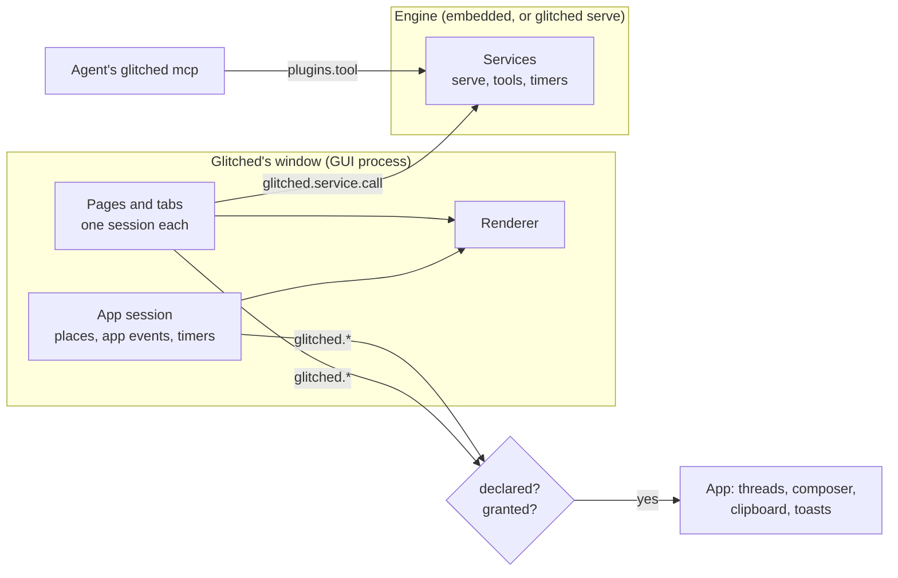

# Plugins

A Glitched plugin is a folder with a `plugin.json` and a JavaScript or TypeScript module, run with [mygo-plugin](https://github.com/yxxbc/mygo-plugin) (Glitched pins a fork of it: see [Upstream](#upstream-and-the-fork)). A plugin can:

- add pages to the sidebar, tabs to a thread's panel, and widgets to Glitched's own views (each thread row, a thread's header);
- replace a component of Glitched's own UI, such as the thread header's buttons, which Glitched itself draws with a built-in plugin;
- hear what happens in the app (threads changing, new messages, settings) and wake on timers;
- act in the app by calling it: start and message threads, draft in the composer, notify, copy;
- offer tools to Glitched's agents;
- do real work outside its sandbox, behind your grants: run the programs it names (`git`, `gh`), keep a SQLite database, reach the network, and run a headless service with no window open.

Everything a plugin draws is data. Glitched checks it and draws it with its own components. A plugin reaches the app only through what its manifest declares and you grant.

| What | Version |
| --- | --- |
| App contract (`contract`, `contractVersion`) | `glitched` 2 |
| Widget tree (`internal/plugins/widget.Version`) | 1 |
| Runtime | github.com/bigx333/mygo-plugin `v0.6.1-glitched.5`, a fork of mygo-plugin's `main` (see `go.mod`) |

A plugin that names another contract, or a newer `contractVersion`, does not load. One that names none loads. Version 2 adds [components](#components), which a plugin replaces; a version 1 plugin loads and runs as before.

## Install and develop

Glitched reads `~/.glitched/plugins` (`$GLITCHED_DIR/plugins`), one folder per plugin. Your choices go to `~/.glitched/plugins.json`: which plugins are off, your grants, settings and consents. A plugin's data is in `~/.glitched/plugin-data/<id>`. It runs from a read-only snapshot of its signed files in `~/.glitched/plugin-snapshots`.

```sh
mkdir -p ~/.glitched/plugins
cp -R examples/plugins/snippets ~/.glitched/plugins/
# Settings › Plugins: "Trust as mine" on Snippets, then grant what it asks for.
```

**Writing your own.**

1. Put the folder in the plugins folder, or link it there: `ln -s ~/src/my-plugin ~/.glitched/plugins/my-plugin`.
2. In **Settings › Plugins**, press **Trust as mine**. Glitched signs it with this device's key (`~/.glitched/plugin-key`).
3. Edit and save. Glitched signs your plugin again and reloads it within about half a second, and **keeps its pages' state**. A save that doesn't load keeps the last good code running, and Settings says why. A change to `plugin.json` reloads the plugin whole: its pages start over.
4. A plugin that fails to load says why under its name in Settings. A page whose `init`, `view` or `update` fails shows the error, with **Start over**.

`examples/plugins/glitched.d.ts` types the whole contract. In TypeScript, reference it with `/// <reference path="./glitched.d.ts" />` (copy it next to your module). A `main` ending in `.ts` compiles as TypeScript. A module is one file: bundle first if you need several.

**Samples** in `examples/plugins`:

| Sample | Shows |
| --- | --- |
| `hello` | a stock mygo-plugin page |
| `counter` | a native view in TypeScript: buttons, a controlled input, a toggle, a section on a condition |
| `snippets` | a form, storage, calls into the app, the denial path, grants, commands |
| `row-status` | a badge on each thread row, from permission-filtered records, counting the changes it hears |
| `focus-timer` | a widget in a thread's header, a panel tab, settings with a status, a timer, a command with a shortcut |
| `word-tools` | tools for agents, with a database |
| `repo-watch` | a headless service on a timer that runs `git`, keeps its checks in SQLite, and answers its page |
| `quiet-header` | a component replaced: the thread header's buttons as a smaller row, with the built-in as the fallback |
| `long-list` | a list of 10,000 rows, drawn as they scroll into view, moved from a search field |

## plugin.json

```json
{
  "id": "focus-timer",
  "name": "Focus timer",
  "version": "0.1.0",
  "main": "index.js",
  "contract": "glitched",
  "contractVersion": 1,
  "capabilities": ["ui.place", "notify"],
  "permissions": { "network": ["api.example.com"] },
  "contributes": {
    "pages": [{ "id": "home", "title": "Focus", "icon": "clock" }],
    "commands": [{ "id": "start", "title": "Start a focus block" }]
  },
  "glitched": {
    "places": [{ "id": "timer", "at": "thread.header" }],
    "tabs": [{ "id": "log", "title": "Focus", "icon": "clock-circle" }],
    "timers": [{ "id": "tick", "every": 30 }],
    "events": ["setting.changed"],
    "settings": [{ "id": "length", "kind": "number", "label": "Length", "min": 5, "max": 90, "default": 25 }],
    "tools": [{ "name": "count_words", "description": "…", "input": { "type": "object" } }],
    "programs": ["git"],
    "service": "service.js",
    "shortcuts": [{ "command": "start", "key": "cmd+shift+f" }]
  }
}
```

mygo-plugin reads the top level: `id`, `name`, `version`, `main`, `contract`, `contractVersion`, `capabilities`, `permissions.network`, `contributes.pages` and `contributes.commands`. Glitched's own additions live in the `glitched` block, so mygo-plugin's fields keep their meaning:

| Field | What | Needs |
| --- | --- | --- |
| `places` | widgets at Glitched's [slots](#places-and-slots) | `ui.place` |
| `tabs` | tabs in a thread's panel | `ui.place` |
| `timers` | `{id, every}` (seconds, at least 30): the service's `timer` export if it has a service, else a `timer` event to its app session | |
| `events` | the [app events](#app-events) it hears | the event's capability |
| `settings` | [settings](#settings) drawn in Settings › Plugins | |
| `tools` | tools for agents: `name` (`^[a-z][a-z0-9_]{0,40}$`, no `__`), `description`, `input` (a JSON Schema of type object) | `tools` |
| `programs` | the programs it runs, each a name, never a path | `programs` |
| `service` | its headless module, a file in its folder | `service` |
| `shortcuts` | `{command, key}`: `key` is modifiers and a key, as `cmd+shift+f`; it needs cmd, ctrl or alt | |
| `settingsPages` | ids of its own pages (`contributes.pages`) listed in Settings rather than over it: see [Settings pages and themes](#settings-pages-and-themes) | |
| `themes` | looks it adds to Appearance: see [Settings pages and themes](#settings-pages-and-themes) | |
| `menus` | its commands in Glitched's menus: see [Menus](#menus) | `ui.place` |

A part whose capability isn't declared, an unknown capability, slot or event, or a bad field stops the plugin from loading, and Settings says which.

Icons (pages, tabs, the `icon` widget) are names of Glitched's icons (`check`, `clock-circle`, `git-branch`, `terminal`, `folder`, `magnifer`, …: the files of `icons/`, and `sparkles`, `code`, `globe`, `file`, `note`, `inbox`, `clock`, `list`, `settings`, `zap`, `folder`, `message`), or an SVG of the plugin's (`"plugin:icon.svg"`, 32 KB at most), drawn in the text's color.

## How it runs



Each plugin runs as up to three kinds of session in the window, each keeping its state in Glitched:

- **A page** (`contributes.pages`), and **a tab** (`glitched.tabs`) per thread, are views of their own: `init`, `view`, `update`.
- **The app session**, one per plugin, draws its places with `place`, and hears app events, timers, commands and what the user does in its places, in `update` with `page: ""`.

The engine runs the plugin's **headless half** with no window: its `service` module, or for a plugin with tools and no service, its main module.

The window never waits for a plugin. One worker per session calls the plugin, one call at a time and in order. The window keeps drawing the last view meanwhile.

### Exports

| Export | Called with | Answers | When |
| --- | --- | --- | --- |
| `init` | `{page, tab?, context?}` | `{state?}` | a page, tab or the app session opens, or starts over |
| `view` | `{page, tab?, context?, state, values}` | `{title?, subtitle?, body}` | after `init`, and once after each batch of events |
| `update` | `{page, tab?, context?, state, event, values}` | `{state?}` | each event; leave `state` out to keep it |
| `place` | `{id, at, state, items: [{key, context}]}` | a widget or `null` per item, in order | for the copies that came or changed; for every copy shown after an event, a setting or a reload ([what a copy may depend on](#places-and-slots)) |
| `rows` | `{list, keys, state, page, tab?, context?, place?}` | a widget or `null` per key, in order | as a [list](#lists) shows rows not drawn for its view |
| `command` | `{id, args}` | nothing | a palette command or shortcut, or a menu item (see [Menus](#menus)) |
| `page` | `{id}` | mygo-plugin's `Page` | stock pages only |
| `tool` | `{name, args, call: {thread}}` | the tool's answer | an agent calls a tool (in the engine) |
| `serve` | `{method, args}` | the method's answer | `glitched.service.call` (in the service) |
| `timer` | `{id}` | nothing | a timer (in the service) |

Every export may be `async`. `context` is the thread record of a tab's thread. State is any JSON value, at most 1 MiB, kept by Glitched, so a runtime restarted after a timeout keeps it. Data that outlasts the app goes in `host.storage` or `glitched.db`.

### Events

```js
{ kind: "ui", type: "click" | "change" | "submit" | "close", handler, node, value?, payload?, place? }
{ kind: "app", type: "thread.changed" | "thread.moved" | "thread.message" | "thread.files.changed" | "setting.changed" | "theme.changed" | "window.focused" | "command" | "grant.changed", data }
{ kind: "timer", id }
```

- `handler` and `payload` are what the widget named (a name, or `{handler, payload}` with up to 4 KiB of JSON). No function crosses into the app.
- `values` maps each input, toggle, select and tabs of the view, by `id`, to what it held when the event happened.
- `place` is set for a widget in a place: `{id, at, key, context}` of the copy it was in.
- `row` is set for a widget in a [list's](#lists) row: `{list, key}`. `modifiers` are the keys held as a list is submitted: `cmd` (Command on macOS, Control elsewhere), `shift`, `alt` and `ctrl` (macOS only).
- While a `change` waits last in line, a later `change` of the same widget replaces it. A change never replaces one before a click or a submit. At most 64 events wait.

### Keyed widgets

Inputs, toggles, selects and tabs keep their value in the app, by `id`, across views:

- A new widget starts with the `value` its view gives.
- While you have changes the plugin hasn't taken, no view changes the widget: typing is never lost to a plugin that is behind.
- Once the plugin took them, a widget with `controlled: true` shows the view's `value` whenever it differs. The plugin owns it: clearing it in the state clears it.
- A widget without `controlled` takes a `value` only when it differs from the last view's. An `onChange` that only validates never clears the field.
- To reset an uncontrolled widget, change its `value`, give it a new `id`, or leave it out of one view.

## Widgets

Every widget is `{type, id?, ...}`. Interactive widgets and dialogs need an `id` (1 to 128 of letters, digits, `_.:/-`), unique in the view. An unknown field, or a field a type doesn't take, is an error. Sizes in points (`width`, `height`, `rowHeight`, an item's `height`, `gap`, `padding`, `radius`, `corners`) take fractions, as half of an odd window's height is; a count, a `weight` or a `maxWidthPercent` is a whole number, and a fraction there is an error that names the field.

| Type | Fields | Fires |
| --- | --- | --- |
| `column`, `row` | `children`, `gap`, `padding`, `align`, `justify`, `grow`, `background`, `border`, `borderOpacity`, `radius`, `corners`, `maxWidthPercent`; for `row`: `wrap`, and with `onClick`: `contextMenu`; with `onClick`, an `id` | `onClick` |
| `card` | `title`, `children`, `gap`, `padding`, `style` (`default` `list`) | |
| `text` | `text`, `style` (`body` `muted` `strong` `heading` `title` `code` `error` `success`), `size` (`small`), `fontSize` (8 to 48), `weight` (100 to 900), `color`, `italic`, `singleLine` (one line, cut short where it doesn't fit), `selectable` | |
| `markdown` | `text` (http and https links open in the browser) | |
| `badge` | `text`, `style` (`default` `accent` `success` `warning` `danger` `count`), `color` | |
| `icon` | `name`, `color`, `fontSize` (8 to 48) | |
| `keys` | `keys`: 1 to 8 keycaps, each up to 16 bytes | |
| `link` | `text`, `href` (http or https, up to 2048 bytes) | |
| `image` | `src` (`plugin:<file>`, PNG, JPEG or SVG up to 4 MiB; or `https://…` with the network grant; or `app:icon`, Glitched's icon), `width`, `height`, `radius` | |
| `table` | `columns` (`{id, title, width?}`, up to 20), `rows` (`{key, cells: {column: text}}`, up to 500) | |
| `divider`, `spacer`, `spinner` | | |
| `button` | `label`, `style` (`default` `primary` `danger` `ghost` `outline` `bordered`), `disabled`, `tooltip`, `opacity` (0.2 to 1); for `default`, `primary` and `danger`: `progress`; for `ghost`, `outline` and `bordered`: `icon`; for `ghost` and `outline`: `compact`; for `ghost`: `active`, `badge`, `size` (`small`), `color`, `padding`, `children` and `gap` in place of the icon, `contextMenu`, `popover` and `open` | `onClick`; with a popover, `onClose` (Escape, a click outside) |
| `tile` | `icon`, `color` (`#rrggbb`), `width` (8 to 64) | |
| `input` | `label`, `placeholder`, `value`, `controlled`, `multiline`, `disabled`, `style` (`default` `search` `bare`: no frame, filling its row and taking the keyboard as it shows, as the palette's search field) | `onChange`, `onSubmit` |
| `toggle` | `label`, `value`, `controlled`, `disabled`, `style` (`default` `switch`) | `onChange` |
| `select` | `label`, `options`, `value`, `controlled`, `disabled`, `width` (40 to 480) | `onChange` |
| `tabs` | `options`, `value`, `controlled`, `disabled`, `style` (`default` `segmented` `control`), `label` | `onChange` |
| `swatch` | `color` (`#rrggbb`), `label`, `active` | `onClick` |
| `item` | `icon`, `text`, `style` (`code` for a monospace text, as a path, that gives way at its start), `label`, `active`, `trailing`, `actions` | `onClick` |
| `menu` | `label`, `options`, `disabled`, `tooltip`, `style` (`default` `outline`); for `outline`: `icon`, `compact` | `onChange` (the chosen option's value) |
| `dialog` | `title`, `open`, `children` | `onClose` (Escape, a click outside) |
| `native` | `name`, `props`, `grow` (see [Native widgets](#native-widgets)) | what the native fires |
| `list` | `label`, `items`, `rowHeight`, `grow` or `height`, `gap`, `padding`, `value`, `controlled`, `input`, `submitOnClick`, `chooseOnHover`, `wrapAround` (see [Lists](#lists)) | `onChange` (the key chosen), `onSubmit` (the key submitted) |

`ghost` and `outline` buttons and menus are drawn as Glitched's header draws its own. A `ghost` button is a square that shows only its `icon` (it needs one), on while `active`, with a `badge` of up to 4 characters over its corner. An `outline` one is a hairline pill with its `icon` and `label`, or the icon alone when `compact`; an `outline` menu adds a chevron. `tooltip` (up to 200 bytes) shows on hover and is the control's name to assistive tools; without one, `label` is. `options` are strings, or `{value, label}`, 1 to 200; a menu's may also be `{separator: true}`, a line between two options. `padding` is 0 to 64, as one number for every side, two for top and bottom then the sides, or four for top, right, bottom and left. A `list` card is Settings' list of rows, with a line between its children. `keys` are drawn as keycaps, as Keybindings shows a shortcut. A `link` opens its `href` in the browser. A `search` input has a magnifier and a clear button. A `bordered` button is Settings' secondary button, with its `icon` before the label. A `progress` button, once clicked, shows a spinner and takes no clicks until the plugin has drawn after the click, so a long `update` (as a commit) shows it runs. A `count` badge is the muted pill a heading's count shows in. A `switch` toggle and `control` tabs are Settings' switch and segmented control; their `label` is only their name to assistive tools. A `swatch` is a dot of its own `color`, the one raw color a widget takes, ringed while `active`; the ring moves to the next one made active, as Appearance's accents do. `segmented` tabs are drawn as the diff panel's Unified and Split switch; their options may each be `disabled`, with a `tooltip` saying why. An `item` is a list's row, as the diff panel's files: its `icon` and `text`, `active` when it is the one selected, its `trailing` widgets after the text, and, while the pointer is over it, its `actions` in their place. `color` and `background` are theme tokens, never raw values: `$text`, `$text.muted`, `$text.faint`, `$accent`, `$success`, `$warning`, `$danger`, `$border`, `$surface`. A `ghost` button's `color` may also be `#rrggbb`, as the sidebar's row actions are tinted. A `row` or `column` has a `border` one point wide in a theme token, drawn at `borderOpacity` (0 to 1) when that is set; `radius` rounds its corners (a `background` alone rounds them by 8), and `corners` sets each one, as four radii: top-left, top-right, bottom-right and bottom-left. `maxWidthPercent` (1 to 100; 0 is none) caps its width at that share of its parent's, as your message's bubble is at most 80% of the timeline.

The sidebar's widgets. A `ghost` button with `children` (`text`, `tile`, `icon`, `badge` and `spacer` only) draws them in place of its icon, with its `padding` and `gap`, as a project's chip; its `label` is then its name to assistive tools. Its `popover` is a `column` of a `width` (120 to 480) that hangs from the button in Glitched's frosted panel while `open`: under it, or above it near the window's bottom. Escape or a click outside fires `onClose`, and the popover stays shut until the plugin draws again, so keep `open` in your state and clear it there. A `row` or `column` with `onClick` is a list row, as the popover's choices: it lights up under the pointer and is clicked as a whole. `contextMenu` opens Glitched's own menu on a right click, with what plugins add to it: `thread:<id>` is a thread's, `project:<key>` a project's (a key from `projects.list`); it needs `threads:read`. A `tile` is a project's mark, its `icon` white on its `color`, as `projects.list` gives them. `opacity` dims a button, as the strip dims the projects filtered out.

A view is at most 1 MiB (4 MiB with a list's items), 2000 widgets, 24 deep, and 32 KiB per string. A place's copy is at most 200 widgets, a component's 2000. A view past a limit is refused whole: the last good one stays, with the error.

### Lists

A `list` is a long list, as the sidebar's threads or a palette's results. The view names every item, as data; Glitched draws the rows in view, and asks the plugin's `rows` export for those alone. A list of 10,000 rows costs a screenful of rows to draw, not 10,000.

```js
export function view({ state }) {
  const items = state.threads.map((t) => ({ key: t.id, label: t.title, version: t.updatedAt, thread: t.id }));
  return { body: { type: "list", id: "threads", label: "Threads", items, grow: true,
    value: state.open, controlled: true, onChange: "open" } };
}

export function rows({ list, keys, state }) {
  return keys.map((key) => ({ type: "row", gap: 9, padding: [0, 6, 0, 8], grow: true, children: [
    { type: "text", text: state.titles[key] },
    { type: "spacer" },
    { type: "text", text: state.ago[key], style: "muted", size: "small", when: "idle" },
    { type: "button", id: "settle", style: "ghost", icon: "check-circle", tooltip: "Settle", when: "hover", onClick: "settle" },
  ] }));
}
```

**Items.** Up to 20,000, each `{key, label, version?, height?, header?, thread?}`. `key` (1 to 256 bytes, unique in the list) is the item's identity: the choice, `rows` and the events name it by its key, so the choice stays with its item as items come, go and move. `label` (1 to 1024 bytes) is the row's name to assistive tools; a thread's item may leave it empty, and its row is then named by the text it shows. `height` (8 to 400 points) is the row's; without it, the list's `rowHeight`, else 32. A `header` heads a section: it is never chosen, and the keys move past it. `thread` is a thread's id: a right click on the row opens Glitched's menu of that thread, with what plugins add to it; it needs `threads:read`. Items are data, not widgets: they count toward neither the 2000 widgets nor the depth, and a view with a list may be 4 MiB, of which all but 1 MiB is its items.

**Size.** A list either grows into the room its parent column leaves (`grow`), or is as tall as its rows up to `height` (8 to 2000 points), past which it scrolls. One of them is needed: a list draws only the rows in it.

**Rows.** Glitched calls `rows({list, keys, state})` with the keys of the rows it shows that it has no drawing of for the plugin's current view, up to 200 at a time, after the view; a list in a place's copy gets that copy as `place`. It answers a widget or `null` per key, in order. A row is drawn again when its item's `version` changes, or when the plugin draws a new view (its state changed), and shows its last drawing meanwhile, so rows never flicker or wait. A row in view with no drawing yet, as a list opens or a new view brings an item into it, is waited for before the frame shows, once, up to 300 ms, as a component's first drawing is: a palette never opens on empty rows. A key may name an item a newer state no longer has, while the view without it is on its way: answer `null` for it. One row that doesn't check draws nothing and says why in its place's error; the others draw. A row answered for a view or version since replaced, `null` or not, never replaces the row's last drawing. A list forgets the rows it no longer shows as it draws for a new view, and all its rows once no view has it; it keeps at most 1000 drawn rows. A row is at most 200 widgets and 16 KiB, and holds nothing that keeps a value or opens: no input, toggle, select, tabs, dialog, popover, progress button or list, and no native widget but a [row's own](#native-widgets). Its buttons and clicked rows fire as anywhere, with `event.row` naming the list and the row's key. A widget of a row with `when: "hover"` shows only while the row is pointed at, and one with `when: "idle"` only while it isn't: a row swaps its time for its actions with no call to the plugin. `when` is a row's alone.

**The choice.** Glitched keeps it, as an input's text: `value` is the key of the item chosen (`""` for none, never a header's), with `controlled` as for [keyed widgets](#keyed-widgets). A click chooses a row; Up, Down, Home and End move the choice while the list has the keyboard, and scroll it into view. Each move fires `onChange` with the key. Enter, Cmd-Enter (Control-Enter off macOS) or a double click fires `onSubmit` with the key and the `modifiers` held. With `submitOnClick`, a click submits as well, as a palette's does. With `chooseOnHover`, the row the pointer moves over becomes the choice (a pointer at rest chooses nothing, though the rows scroll or move under it, so the keys still move it), and with `wrapAround`, Up from the first item goes to the last and Down from the last to the first, as a palette's choice moves; Home and End stop at the ends. With `noKeys`, the list never takes the focus and no key moves or submits it: only the pointer chooses, as in the sidebar, which has no `input`. `input` names a single-line input of the view, which has no `onSubmit` of its own and moves no other list: Up and Down in it move the list's choice, and Enter submits it, so the keyboard stays in the search field. A key pressed while the plugin hasn't yet taken an event sent before it, as the query just typed, waits till it has, then moves or submits the list the plugin draws for it, and what the input types behind it waits behind it: a query typed and Enter at once submit what that query finds, whatever is typed next.

Glitched draws each row in its own list row, which lights up under the pointer and shows the choice, as the sidebar's rows do; the plugin draws what is in it. A `row` with `grow` fills it.

## Places and slots

A place puts widgets in Glitched's own views. Declare it (`glitched.places`, with `ui.place`), and export `place`, which draws the copies Glitched asks for in one call:

```js
export function place({ id, at, state, items }) {
  return items.map(({ key, context }) => context.status ? { type: "badge", text: context.status } : null);
}
```

| Slot | Stable | Copies | Context |
| --- | --- | --- | --- |
| `thread.row` | yes | one per sidebar row, keyed by the thread's id | the thread |
| `thread.header` | yes | the thread shown | the thread |
| `sidebar.footer` | no | one | none |

Stable slots keep their name and context across Glitched's updates; others may move. A copy shows its last drawing while the next is drawn, so rows never wait or flicker. What the user does in a place reaches `update` with `event.place`.

**What a copy may depend on.** A copy's drawing must depend only on the app session's state, the copy's own `key` and `context`, and your settings (`host.setting`). Glitched relies on that to draw only what changed:

- When copies come or their context changes, and nothing else does, `place` is called with those copies alone. `items` then holds only those copies, not every copy shown, and a copy that didn't change keeps its drawing without being asked again. Don't count `items` or draw one copy from another's context.
- After anything else, every copy shown is drawn again. That covers an event or a timer `update` took, a setting changed, or your code reloaded, even when the state comes back the same.
- `null` for a copy leaves it empty, even if it showed a widget before.

Copies are drawn in batches of up to 200.

### Menus

A plugin's command can join a menu of Glitched's: a thread row's context menu, a project's, or the actions under a message. Glitched draws the menu; the plugin's items come after its own, past a line, with the command's title. Choosing one runs the plugin's `command` export with `args` about what the menu is on:

```json
{
  "capabilities": ["ui.place"],
  "contributes": { "commands": [{ "id": "quote", "title": "Quote" }] },
  "glitched": { "menus": [{ "command": "quote", "at": "message.actions", "icon": "copy" }] }
}
```

| Menu | `args` |
| --- | --- |
| `thread.menu` | `{thread}`: the thread's record, `{id}` alone without `threads:read` |
| `project.menu` | `{project: {name, workspace, machine}}`: `workspace` and `machine` only with `threads:read` |
| `message.actions` | `{thread, message: {role, text}}`: `text` only with `messages:read` |

A message's actions are buttons, so their items name an `icon`, one of the app's; a menu's don't. The menus themselves stay Glitched's: Rename, Snooze, Delete and the rest can't be removed or replaced.

**Panel tabs** (`glitched.tabs`) show as buttons in a thread's header and open in the panel beside the chat, one session per thread, with the thread as `context`. `glitched.tabs.open(id)` opens one.

## Components

A component is a part of Glitched's own UI that one plugin draws. Glitched draws each of its components with a built-in plugin, and your plugin can draw one in its place. A replacement is a place whose `at` names the component, with `"replaces": true`. It needs `contractVersion` 2 and the `ui.replace` capability, which you grant:

```json
{
  "contract": "glitched",
  "contractVersion": 2,
  "capabilities": ["ui.place", "ui.replace", "threads:read"],
  "glitched": {
    "places": [{ "id": "actions", "at": "thread.header.actions", "replaces": true }]
  }
}
```

Your `place` export draws it as it draws any place.

| Component | Copies | Context |
| --- | --- | --- |
| `thread.header.actions` | the thread shown, keyed by its id | `{thread, local, narrow, panels: {terminal, diff, preview}, changedFiles}` |
| `hero.heading` | one, keyed `hero` | `{}` |
| `thread.empty` | the thread shown while it has no messages, keyed by its id | `{thread}` |
| `settings.page.general` | one, keyed `page` | `{settings, choices: {newThread, defaultModel, timestamps}}` |
| `settings.page.appearance` | one, keyed `page` | `{settings, themes, accents: [{name, color}]}` |
| `settings.page.about` | one, keyed `page` | `{version, toolkit, checking, source}` |
| `settings.page.keybindings` | one, keyed `page` | `{keybindings: [{label, keys}]}` |
| `thread.row.actions` | the sidebar row pointed at, keyed by its thread's id | `{thread, section, snooze: [{when, joke, emoji, until}]}` |
| `sidebar.projects` | one, keyed `strip` | `{projects, filtered, picking, machines}` |
| `thread.panel.diff` | two for the thread shown: `<id>/header` and `<id>/body` | `{thread, part, local, files: [{path, name, add, del, reviewed, read}], shown, layout, splitFits, splitWidth, wrap, canOpen}` |
| `composer` | one, keyed `composer` | `{thread}` |
| `composer.send` | the open composer, keyed by its thread's id, or `draft` for a new thread's | `{thread, draft, working}` |
| `composer.access` | the open composer, keyed as `composer.send` | `{thread, access, levels: [{name, about}]}` |
| `palette` | the open palette, keyed `palette:<n>`, a new key each time it opens | `{query, actions: [{id, section, label, hint?, icon, also?}], threads: [{id, title, project, ago}], rowHeight, headerHeight, noneHeight}` |
| `timeline.message` | each row of the thread shown but its approval, question and report cards, keyed by the row's key | `{key, kind, streaming, note, failed}` |
| `sidebar.body` | two, keyed `inbox` and `bottom`; `bottom` only while Working, Snoozed or Settled has threads | `{part, maxHeight, emptyHeight, page, selected, machines, slots, sections: [{id, title, empty, closed, rows: [{thread, title, depth, status, kids, renaming} or {more, parent?, depth, full?}]}]}` |
| `agents.body` | the open agents panel, keyed by the id of the thread shown | `{rows: [{thread, title, depth, status}], more}` |

`thread.header.actions` is the buttons at the right of a thread's header. Glitched keeps the header's frame, its drag region, the title, the pills, the `thread.header` slot and the panel tabs' buttons. `local` says the thread's workspace is on this machine. `narrow` says the chat is under 700 points wide, where the built-in shows icons only. `changedFiles` counts the files the agent changed. Without `threads:read` the thread is `{id}` alone, as everywhere.

**Which plugin draws it.** Your plugins come before the built-in, in the order of their folders, and only one draws: the first that runs, is granted `ui.replace`, and whose last drawing went well. The built-in draws it when yours is off, didn't load, isn't granted, or failed (a `place` or `update` that threw or took too long), and Settings › Plugins says why in your plugin's row. A copy it answers `null` for is drawn by the next plugin, or by Glitched where the component has a native body: your row says **Answered null** when that is every copy shown, **Drawing some**, with how many it left, when it is some, and **Not drawn yet** while no plugin has drawn the copies shown, it included. Settings says this of the copies as the chat last drew them, while nothing that decides who draws them has changed since; after such a change it says only who should draw it, until the chat draws again. A change it can't see, as a panel closed by its shortcut while Settings is open, shows once the chat draws again. Its **Parts of Glitched** view lists every component with the plugin that draws it now. Every plugin that could draw it is given the copy all along, so a fallback shows at once. A copy no plugin has drawn yet, as a panel opening or a thread shown for the first time, is drawn before it shows: Glitched waits for it, the user's plugin first, for up to 300 ms in all, so a component never opens empty. A frame waits at most once for each component, for every new copy it has met so far: the diff panel's header and body are drawn in one wait. A new copy met later in the same frame shows the component's native body if it has one, and nothing if not, until its drawing comes, usually by the next frame. Drawing a new copy never takes another copy's drawing away. Glitched waits once for each version of a copy, so a copy the plugin leaves `null` is not waited on again. Past that, it shows as soon as the plugin answers. A plugin that is waiting on a call into the app as the copy opens (`await glitched.toast(…)` in its `init`, say) can't answer before the window does, so the next plugin, in the end the built-in, draws that first frame at once, and yours takes over once it has drawn. Keep `place` fast.

**Off limits.** These never take a replacement, whatever a manifest says or a grant allows: `approval.card`, `question.card`, `settings.plugins`, `settings.servers` (pairing an engine), `settings.providers` (the program Glitched runs as an agent) and `confirm.destructive`. A plugin that names one does not load, and Settings says why. They are where you answer an agent, pair a machine, or delete something, so only Glitched draws them.

`composer` is the composer's layout, around the native `composer.input`, which is the card the user writes in, with its pickers, Send and what comes and goes with it as it morphs. A replacement places `composer.input` exactly once, with widgets around it if it likes, and only in rows, columns and cards, where it always shows: never in a dialog, a popover, or an item's trailing or actions. A layout that leaves it out, places it twice or puts it anywhere else fails, and the next plugin, in the end Glitched, draws the composer. When none draws it, Glitched draws its own, as it does when the replacement throws or answers `null`. `thread` is the thread whose composer it is.

`composer.send` is the composer's Send, which stops the agent while it works and the composer holds nothing to send. `draft` says the composer holds something to send, and `working` that the agent runs a turn. A replacement sends what the composer holds with `glitched.composer.submit(thread)`, as Send does, and stops the agent with `glitched.threads.interrupt(thread)`, so it needs `threads:write` granted as well as `ui.replace`. `composer.access` is the access picker. `access` is the level in force, and `levels` what the picker offers, by name, with what each lets agents do. A replacement sets the access with `glitched.threads.setAccess(thread, name)`, which takes only one of those names, so it needs `threads:access` granted as well as `ui.replace`. For both, the built-in is Glitched's own: without the grants, or when the replacement fails, Glitched draws it. While a replacement draws, Glitched keeps its own Stop beside Send while the agent works, and its own sign of the access in force beside the picker, whatever the replacement draws; ⌘⏎ sends and stops as it does with Glitched's. Approvals and questions still come to their cards at any access, and no plugin answers them.

`timeline.message` is a row of the chat timeline: its chrome in widgets, around the native `transcript.body`, which, bare, draws only what the row says: a message's text and selection, a run's work log with its steps and diffs, or an error's words. The built-in Timeline rows draws your message as a bubble on the right, at most 80% wide, in `$surface` with a `$border` and corners of 16, 16, 4 and 16, its words inset by 10 and 14, its `note` under it in small `$text.faint` (`$danger` when it `failed`) with `transcript.retry` after it; a reply and a work log as `transcript.body` alone; and a failed command or a run's error in a `$danger` outline at 35%, with `transcript.retry` after a failed command's words. A copy restyles any of it with the same widgets, in theme tokens, so it follows light, dark and the accent. A message's Copy, Edit and Retry stay Glitched's, shown as it is pointed at: under `transcript.body`, but for a bare body of your message, under the whole copy, as the bubble is the copy's. A replacement places `transcript.body` exactly once, with widgets around it, as `composer` places `composer.input`: one that leaves it out, places it twice or puts it where it may not show fails, and Glitched draws its own row, as it does when the replacement throws or answers `null`. Its text is never the plugin's: the context says which row a copy is and what it is doing, not what it says. `key` stays the same while the row changes; `kind` is `user`, `assistant`, `work`, `failed` (a command that failed) or `error` (why a run failed). `streaming` says a reply is still coming in; as it does, its context doesn't change, so `place` isn't asked again until it ends, and `transcript.body` shows each word as it comes. `note` is what shows under a message that hasn't simply been sent (queued, sending, cancelled, not sent), and `failed` says its send failed. Approval, question and report cards stay Glitched's, as do the list itself, its scrolling, the turn markers and Jump to latest.

`hero.heading` is the greeting over a new thread's composer, inside the hero's fade; Glitched keeps the composer, the workspace picker and the layout. `thread.empty` is what a thread with no messages shows where its messages will be. `settings.page.general` is Settings' General page. `settings.page.appearance` is the theme and the accent of Appearance; the material under them (Liquid Glass, its tint, the wind and the font size) stays Glitched's. Their `settings` are what `glitched.app.settings.get()` answers, and what they change they set with `glitched.app.settings.set`, so a replacement needs `settings:write` granted as well as `ui.replace`; without it, the built-in draws them. Appearance's `themes` are the themes' names, System first and plugins' last; it draws each with the native `theme.card`. `settings.page.about` and `settings.page.keybindings` are the About and Keybindings pages of Settings, beside its sidebar and inside the page's scroll. About's `checking` is true while **Check for updates** runs, which `glitched.app.checkForUpdates()` starts; `source` is the repository's address. Keybindings' `keys` are each shortcut's keycaps, as `["⌘", "K"]`.

`thread.panel.diff` is the diff panel beside the chat. Its `header` copy is drawn in the panel's title bar, whose height, drag region and window buttons stay Glitched's; its `body` copy below it. `files` are the files the agent changed, in the order it first changed them, each with the `name` the user reads it by, from the workspace, with the lines each change adds and deletes as its diff has them now; `reviewed` is the user's mark, and `read` says the file's diff is read, which marking it needs. `shown` is the file the diff shows, `""` with none. `layout` is `unified` or `split` as shown: Split falls back to Unified while `splitFits` is false, short of `splitWidth` points. `canOpen` says there is an editor to open a file in. Its context holds the thread's files, so a replacement needs `threads:read` granted as well as `ui.replace`; without it, the built-in draws the panel. The built-in draws the header and the list of files, and places the native `diff.body` under them.

`thread.row.actions` is what a sidebar row shows in place of its time while it's pointed at, and while a popover of its is open. `section` is the one the row shows in (`inbox`, `working`, `snoozed`, `settled`), which, for a moment after a move, is still the one it left; without `threads:read` it is `""`, as the record is `{id}`. `snooze` are the times Glitched offers, `until` in RFC 3339. Glitched keeps the row itself: its tile, title, badges, children's toggle, click and menu. A replacement needs `threads:write` granted as well as `ui.replace`, as its buttons move threads; without it, the built-in draws them.

`palette` is what's on the command palette's glass: its search field, its results and its keys. Glitched keeps the dialog, its glass and backdrop, and Escape. Each opening is a copy of its own, so none of the last one's query or choice shows in the next, and the built-in closes only its own opening. `query` is the query it opened with (empty from ⌘K); `actions` are `commands.list`'s, and `threads` every thread, the most recently active first, with its project's name and how long ago it was last active. `rowHeight`, `headerHeight` and `noneHeight` are how tall Glitched's own palette draws a row, a section's header and No results, in points: they follow the interface font's lines on each platform, so a copy that draws its rows at them matches it on macOS as on Linux. The built-in filters them as the query changes, runs an action with `commands.run`, and opens a thread with `threads.open` after `palette.close`, with its diff on ⌘↩. A replacement needs `threads:read` granted as well as `ui.replace`, and `commands` to run actions.

`sidebar.body` is the sidebar's threads, under the projects' strip: the `inbox` copy, which grows into the room the sidebar leaves, and the `bottom` copy, Working, Snoozed and Settled, at most `maxHeight` points tall (half the sidebar) before it scrolls. Glitched works out which threads go in which section and in what order; `sections` are a copy's, each with its `id` (`inbox`, `working`, `snoozed`, `settled`), its `title`, what it says while `empty`, whether the user `closed` it, and, while open, its `rows`: a thread's, then its children's under it, each `depth` deeper. `status` is what the thread does (`idle`, `working`, `waiting` on you, `completed`), `kids` says it has children shown, and `renaming` that the user renames it. A section lists its newest `page` threads (100), and a thread its first `page` children, till the user asks for more: past them, a row with `more`, how many aren't listed, and the `parent` whose children they are (none for a section's), stands in their place, and `glitched.sidebar.more` lists the next page of the section, by its `id`, or of the parent's children. The pages asked for stay till Glitched quits, as a section closes and opens; the thread shown and its parents, those shown before, and threads that moved section are listed where they sort, past the pages, a page of them at most but for the thread shown and its parents. A copy's rows, with its headers, stay within a list's bounds (20,000 items) however many threads there are and pages the user asks for: past them, the `more` row is `full`, and the rest are the palette's to find. `emptyHeight` is how tall Glitched draws what an empty section says. `selected` is the thread shown, `machines` says there are several, and `slots` that plugins place widgets in the rows (`thread.row`). The built-in draws each copy as a [list](#lists) with `noKeys`, a `sidebar.section` header over each section, each row of the `thread.` natives, and a `more` row as "Show 100 more", or as many as are left, which a click or the keys choose to show them, or, `full`, as how many more aren't listed, to search for. Glitched keeps the sidebar's frame, Search, the projects' strip, the footer, and what a row does: a click shows the thread and gives its composer the focus, a right click opens its menu, and rows fold in and out as they join and leave a section. A copy waits for the plugin to draw each change of its context, as for its first drawing, so the rows keep up with the threads. A replacement needs `threads:read` granted as well as `ui.replace`; when none draws a copy, Glitched draws its own.

`agents.body` is the agents panel's rows, under its head, in the panel the Agents pill over the composer grows into. `rows` are the threads under the one shown, each `depth` levels under it, depth first: a thread, then those under it, siblings newest first; `status` is what the thread does, as in `sidebar.body`. Past the first five, `more` says the rest aren't listed till the user asks for them with More, and the copy's context then lists them all. The built-in draws the copy as a [list](#lists) with `noKeys`: each row of the `thread.` natives, the thread's dot, its title, how long ago it changed and, pointed at, `thread.actions`, and More as a last item with no `thread`. Glitched keeps the pill, the panel and how it grows, its head with Stop all and close, Escape, and what a row does: each rises into its place after the one above it as the panel opens, a click shows its thread, a right click opens its menu, and a click on the item with no thread shows every one. A replacement needs `threads:read` granted as well as `ui.replace`; when none draws the copy, Glitched draws its own.

`sidebar.projects` is the strip of projects under Search. `projects` are `projects.list`'s, each `filtered` while the sidebar shows it; `filtered` says the sidebar shows only some, `picking` that Add project's folder picker is open, and `machines` that there is more than one machine, whose names then tell projects apart. A replacement needs `threads:read` granted as well as `ui.replace`.

### Native widgets

A native widget is one of Glitched's own views, which a plugin places in its layout and Glitched draws: a surface too heavy or too live for widgets, as the diff of a file. The plugin says where, with which props, and hears what it fires:

```json
{ "type": "native", "id": "diff", "name": "diff.body", "props": { "path": "src/main.go" }, "grow": true, "onChange": "marked" }
```

| Native | Props | Draws in | Fires |
| --- | --- | --- | --- |
| `theme.card` | `theme`: a theme's name, from the context's `themes` | `settings.page.appearance` | `onChange` with the theme's name when it is clicked |
| `diff.body` | `path`: the file, one the thread changed | `thread.panel.diff` | `onChange` with `{path, remaining}` when a change is marked reviewed in it |
| `composer.input` | none | `composer` | nothing |
| `transcript.body` | `bare`: only what the row says, with nothing around it | `timeline.message` | nothing |
| `transcript.retry` | none | `timeline.message` | nothing |
| `thread.row.actions` | none | a row of `sidebar.body` | nothing |
| `thread.rename` | none | a row of `sidebar.body` | nothing |
| `thread.tile` | none | a row of `sidebar.body` | nothing |
| `thread.status` | `dot`: a dot in place of the mark; `size`: the square it sits centered in | a row of `sidebar.body`, `palette` or `agents.body` | nothing |
| `thread.age` | none | a row of `palette` or `agents.body` | nothing |
| `thread.actions` | none | a row of `agents.body` | nothing |
| `thread.children` | none | a row of `sidebar.body` | nothing |
| `thread.title` | `child`: a child's, smaller | a row of `sidebar.body` or `agents.body` | nothing |
| `thread.mark` | `child`: a child's | a row of `sidebar.body` | nothing |
| `thread.slot` | none | a row of `sidebar.body` | nothing |
| `thread.machine` | none | a row of `sidebar.body` | nothing |
| `sidebar.section` | `section`: a section's id, from the context's `sections` | `sidebar.body`, in a list's row or not | nothing |

`diff.body` draws the file's diff, the hunk bar and its shortcuts, or why it can't: no changes yet, the files on another machine, still reading, not shown (binary, over 1 MB, outside the workspace), or HEAD's side unknown. It fills its parent's width, and with `grow` the height its parent column leaves; without, its own.

`composer.input` draws the composer: the agents strip over the card, the card the user writes in, compact or full as it morphs, with its pickers, Send (or a plugin's `composer.send` and `composer.access`), and the workspace under it. Its text, focus and keys are Glitched's. It lets the pointer through to the chat around it, as every native widget's frame does.

`transcript.body` draws the timeline row whose copy it is in, live: your message's text, a reply's words as they stream in, its selection, a work log's steps and diffs, an error's words. A copy's own row is the only one it draws. With `props: {bare: true}` it draws only that, with nothing around it, and the copy draws the rest, as the built-in does: the bubble, the note, the outline, and `transcript.retry` for a failed command. A bare body's `padding` insets your message's or a reply's words inside their own text, so a click, a drag or a right click in it selects them, as in a bubble it should; padding on a box around it doesn't. Without `bare`, it draws the row as Glitched did before the built-in drew its chrome: your message in its bubble with its note, Retry and Dismiss, an error in its outline. Until a plugin has drawn a row, and while the built-in's drawing is of the row as it was, Glitched draws the built-in's own drawing of it as it is, so a selection in the row lasts while the built-in takes over or gives way, and a message that fails says so at once. A copy that places `transcript.body` elsewhere than the built-in does, or with another id than `body`, clears the row's selection when it takes over or gives way.

`transcript.retry` is the Retry and Dismiss of a command that failed, for a copy around a bare `transcript.body`: a message not sent, or the row of another failed command, 8 points after what comes before it. In any other row it draws nothing and takes no room of its own, but a `gap` of the row it is in stays, as does what `grow` gives it, so place it in a row with no gap, and without `grow`.

The `thread.` natives sit only in a [list's](#lists) row, and draw about the thread its item's `thread` names; in a row of an item with none, or of a thread gone, they say so in its place. The components they draw in are `palette`, `sidebar.body`, and `agents.body`. `thread.row.actions` is the row's actions, as the sidebar's rows show them: the `thread.row.actions` component, the built-in's snooze and settle or a replacement's, with its popover. Place it with `when: "hover"`: a row whose actions' popover is open shows as pointed at while it is, so they stay. `thread.rename` is the field that renames the thread, while the user renames it from its menu, and nothing otherwise; Enter or a click away keeps the title, Escape goes back. `thread.tile` is the thread's project's tile with the thread's state as a badge on it, and the jokes snooze and settle play on it. `thread.status` is the mark of what the thread is doing, as before a child's title: a spinner while it works, amber while it waits on you, green when done; with `dot`, the agents panel's dot, which breathes while it works and is red once it failed. `thread.children` is the toggle of the thread's children in the sidebar, their count and a chevron, and nothing when it has none. `thread.age` is how long ago the thread was last active, as the palette shows it, or as the agents panel does in a row of `agents.body`, which keeps time with no call to the plugin. `thread.actions` is the … that opens the thread's menu, as the agents panel's rows show it while pointed at; place it with `when: "hover"`. `thread.title` is the thread's title, bold while it is unread; in a row of `agents.body`, as the agents panel shows it. `thread.mark` is what a sidebar row shows at its end while it isn't pointed at: a red dot once a command failed, when a snoozed thread wakes, a dot while it is unread, or else how long ago it was active; a child's shows how long ago, and nothing when it has children. `thread.slot` is what plugins place in the row (`thread.row`). `thread.machine` is the thread's machine, while there are several, and nothing otherwise. `sidebar.section` is a section's header, as the sidebar draws it, which opens and closes it on a click; it is the one native that draws about no thread and may sit in a list's row.

`theme.card` draws a theme's preview, its sidebar, chat and terminal colors, with its name under it, ringed while it is the one chosen; with `grow` the cards of a row share its width.

A native widget draws only in the components its row names, and `diff.body` about the copy's own thread; a thread is never a prop. Anywhere else (a page, a tab, a slot) it says so in its place. Its name must be one of the table: an unknown name refuses the view, as does a part of the UI that is off limits (`approval.card` and the rest), so a plugin can't place a locked part any more than replace it. A prop it doesn't take, or of the wrong type, refuses the view too, and props are at most 4 KiB.

### Built-in plugins

Built-in plugins are compiled into Glitched (`internal/plugins/bundled`) and listed in Settings › Plugins as **Built into Glitched**. Each is verified as yours are: Glitched writes it to `~/.glitched/plugin-bundled`, checks its signature, and runs it from a read-only snapshot. It must be signed by Glitched's release key, whose public half is compiled in. It has the capabilities it declares without asking, and you can take any of them back in Settings.

| Built-in | Draws | Asks for |
| --- | --- | --- |
| `header-actions` | `thread.header.actions` | `ui.place`, `ui.replace`, `threads:read`, `programs` (`git`) |
| `diff-panel` | `thread.panel.diff` | `ui.place`, `ui.replace`, `threads:read`, `clipboard` |
| `settings-pages` | `settings.page.general`, `settings.page.appearance`, `settings.page.about`, `settings.page.keybindings` | `ui.place`, `ui.replace`, `settings:write` |
| `greetings` | `hero.heading`, `thread.empty` | `ui.place`, `ui.replace` |
| `row-actions` | `thread.row.actions` | `ui.place`, `ui.replace`, `threads:read`, `threads:write` |
| `project-strip` | `sidebar.projects` | `ui.place`, `ui.replace`, `threads:read`, `threads:write` |
| `composer` | `composer` | `ui.place`, `ui.replace` |
| `timeline` | `timeline.message` | `ui.place`, `ui.replace` |
| `palette` | `palette` | `ui.place`, `ui.replace`, `threads:read`, `commands` |
| `sidebar` | `sidebar.body` | `ui.place`, `ui.replace`, `threads:read` |
| `agents` | `agents.body` | `ui.place`, `ui.replace`, `threads:read` |

Header actions' **Open in** opens the thread's workspace in Cursor, VS Code, Zed or, below a line, the file manager, with `glitched.openIn`. Its **Commit & push** opens a dialog that lists every changed file, the branch, where it pushes, and a message (the thread's title to start), and says that your git hooks don't run for a plugin's git. On **Commit & push** in the dialog, which shows a spinner while git runs, it runs `git add -A`, `git commit -m <message>`, then `git push`, or `git push -u origin <branch>` when the branch tracks nothing yet. It never forces. It refuses before running anything when there is nothing to commit, HEAD is detached, a merge has conflicts, or the message is empty. A push that fails or takes over 20 seconds keeps the commit and says so. A repository with no `origin` keeps the commit here.

Row actions draws Snooze, with its popover of times and their jokes, and Settle on a row in the inbox, and Back to inbox on a snoozed or settled one; each moves the thread with `threads.setDisposition` and its joke. Project strip draws All, a chip per project that toggles it in the filter (with the project's menu on a right click), and Add project.

Diff panel draws the header (Changes, the count, the Unified and Split switch, Wrap long lines, Close diff) and the list of files over `diff.body`. Pointed at, a file shows Mark reviewed, Copy path and, with an editor, Open in editor. It lists up to 300 files, then how many more.

### Copy and edit

To change a built-in, open its row in Settings › Plugins and press **Make a copy**. Its files go to `~/.glitched/plugins/<id>`, signed with this device's key, with the grants the built-in had. The copy has the built-in's id, so it runs in the built-in's place and keeps its data. Edit it and it reloads as any plugin of yours does. **Revert to built-in**, in the copy's row or the built-in's, moves your folder to `~/.glitched/plugins/.reverted/<id>-<time>`, so nothing you wrote is lost, and runs the built-in again. A folder you make by hand with a built-in's id shadows it too, but starts with no grants.

### Signing a built-in

A change to a built-in's files must be signed again with the release key, or `TestTheBuiltInPluginsAreSignedByTheReleaseKey` fails. The private key is on the maintainer's Mac and in the repository's Actions secret `GLITCHED_RELEASE_KEY`, so a change is signed by a workflow:

1. Push the change to a branch of `bigx333/glitched` and open its pull request.
2. Run `gh workflow run sign-bundled.yml -R bigx333/glitched -f branch=<branch>`, or **Actions › Sign built-in plugins › Run workflow**.
3. The workflow signs every built-in on the branch, commits the changed `signature.json` files to it, and dispatches CI on the new head, since a push made with `GITHUB_TOKEN` starts no checks. A branch that is already signed gets no commit.

It refuses `main` and any name that is not a branch of the repository. It builds the signer from `main`, so the key never runs through a branch's code. Only someone with write access can dispatch it. Pull your branch after it runs.

The maintainer can sign locally too: `GLITCHED_RELEASE_KEY=~/.glitched-release/release-key go run ./cmd/sign-bundled`.

**Rotating the key.** On the maintainer's Mac:

1. Move the old key aside: `mv ~/.glitched-release/release-key ~/.glitched-release/release-key.old`.
2. On a new branch, run `GLITCHED_RELEASE_KEY=~/.glitched-release/release-key go run ./cmd/sign-bundled -new`. It makes the key (0600), writes its public half into `ReleaseKey` in `internal/plugins/bundled/bundled.go`, and signs every built-in.
3. Run `gh secret set GLITCHED_RELEASE_KEY -R bigx333/glitched < ~/.glitched-release/release-key`.
4. Commit `bundled.go` and the `signature.json` files, and merge the pull request. Then delete the old key.

Every open branch that changes a built-in must take `main` in after the rotation merges, then run the workflow again. A copy of yours is signed with your device's key, so a new release key changes nothing installed.

## App events

A plugin hears the events its manifest lists, if it may:

| Event | Data | Needs |
| --- | --- | --- |
| `thread.changed` | the thread's record (any of it changed), or `{id, deleted: true}` | `threads:read` |
| `thread.moved` | `{thread, from, to}`, as a thread moves between the sidebar's sections | `threads:read` |
| `thread.message` | `{thread, role, text}`, each new message of a thread you have open: from when it's first shown, and while you're away from it once it was | `messages:read` |
| `thread.files.changed` | `{thread, files}`, the files of a thread you have open that the agent edited since you were last told, as `thread.message` is | `threads:read` |
| `setting.changed` | `{id, value, was}` | |
| `theme.changed` | `{appearance}` | |
| `window.focused` | `{focused}`, as the window comes to the front or goes behind | |

`command` (a command of its own ran), `grant.changed` (`{capability, granted}`, a grant of its own given or taken back) and `timer` reach the plugin's sessions with `update`; `grant.changed` reaches its pages and tabs too, so what they show follows at once. A thread record is `{id, title, workspace, status, machine, updatedAt, section, disposition, unread, parent, ancestors, children, requests, tokens}`. `section` is where the sidebar files it: `working` while its agent runs, else `snoozed`, `settled` or `inbox`. `disposition` is how the user left it, `{state, until?}` with `state` `inbox`, `snoozed` or `settled`, counting what was just done here before the engine has it, so a plugin's view follows an action at once. `parent` is the thread that started it, `ancestors` that one's line, the furthest first, and `children` the threads it started, newest first. `requests` counts the approvals and questions it waits on, and `tokens` what its own runs used. Fields that are empty, false or zero are left out. Without `threads:read` it is `{id}` alone, in places and tabs too.

## Calling the app

A plugin acts in the app by calling it, from any export, and awaits the answer:

```js
const threads = await glitched.threads.list();
await glitched.composer.draft("Review the branch");
try {
  await glitched.threads.create(prompt, { title });
} catch (e) {
  if (e.code === "denied") { /* say which grant is missing */ }
}
```

Each call runs on the UI thread (the engine's queue, for a service), checked as it runs: a call that waits while its grant is taken back fails, and one from a runtime that stopped, as a plugin turned off or reloaded, does nothing.

| Call | Answers | Needs |
| --- | --- | --- |
| `glitched.toast(title, description?)` | | |
| `glitched.openURL(url)` (http, https) | | |
| `glitched.pages.open(page)` (its own) | | |
| `glitched.tabs.open(tab)` (its own) | | `ui.place` |
| `glitched.settings.get()` | its settings, typed, by id | |
| `glitched.settings.status(setting, {badge?, tone?, text?} \| null)` | | |
| `glitched.clipboard.write(text)` | | `clipboard` |
| `glitched.notify(title, body?, {thread?})` | | `notify`; naming a thread, `threads:read` |
| `glitched.composer.draft(text, workspace?)`, or `(text, {thread})` | | `composer`; naming a thread, `threads:read` |
| `glitched.threads.list()` | thread records, newest first | `threads:read` |
| `glitched.threads.open(thread)` | | `threads:read` |
| `glitched.threads.create(prompt, {title?, workspace?})` | `{thread}` | `threads:write` |
| `glitched.threads.send(thread, text)` | `{message}` | `threads:write` |
| `glitched.threads.rename(thread, title)` | | `threads:write` |
| `glitched.threads.delete(thread)` | | `threads:write` |
| `glitched.threads.setDisposition(thread, {state, until?}, {animation?})` | | `threads:write` |
| `glitched.threads.markRead(thread)` | | `threads:write` |
| `glitched.threads.interrupt(thread)` | | `threads:write` |
| `glitched.threads.configure(thread, {model?, effort?, fast?})` | | `threads:write` |
| `glitched.threads.setAccess(thread, access)` | | `threads:access` |
| `glitched.composer.submit(thread)` | | `threads:write` |
| `glitched.models.list()` | `{models: [{name, provider, description}], efforts}` | |
| `glitched.commands.list()` | `[{id, section, label, hint?, icon, also?}]`, the palette's actions, in its order | `commands` |
| `glitched.commands.run(id, palette?)` | | `commands` |
| `glitched.projects.list()` | `[{key, workspace, machine, name, icon, color, filtered}]`, in the sidebar's order | `threads:read` |
| `glitched.projects.filter(keys)` | | `threads:read` |
| `glitched.projects.add()` | | `threads:write` |
| `glitched.projects.remove(workspace, machine?)` | | `threads:write` |
| `glitched.panels.toggle(panel, open?)` (`terminal`, `diff`, `preview`) | the panels' state | `ui.place` |
| `glitched.palette.close(palette?)` | | `ui.replace` |
| `glitched.sidebar.more(key)` | | `threads:read` |
| `glitched.panels.state()` | `{terminal, diff, preview}`, each open or not | `ui.place` |
| `glitched.openIn(app, thread)` (`cursor`, `vscode`, `zed`, `finder`) | | `threads:read` |
| `glitched.app.checkForUpdates()` | | |
| `glitched.app.settings.get()` | `{theme, accent, newThread, defaultModel, timestamps, confirmDelete, streaming, notifications}` | |
| `glitched.app.settings.set(key, value)` | | `settings:write` |
| `glitched.diff.set(thread, {shown?, layout?, wrap?})` | | `ui.place` |
| `glitched.diff.setReviewed(thread, path, reviewed?)` | | `threads:read` |
| `glitched.diff.openFile(thread, path)` | | `threads:read` |

`threads.setDisposition` puts a thread in the inbox, snoozes it till an `until` to come (RFC 3339), or settles it, which settles every thread under it and stops their agents. `animation` plays one of the row's jokes as it moves, with Glitched's toast: `snooze` (Sleeping until …) as it is snoozed, `settle` (Settled. Phew.) as it is settled, or `undo` as it goes back to the inbox; any other, or one that doesn't match the state, is refused. `threads.open` shows a thread, as the palette does, and scrolls the sidebar to its row. `threads.markRead` marks a thread read, and `threads.interrupt` stops its agent if one runs. `threads.configure` sets the model, effort and fast mode the thread's next turn runs at, as the composer's model picker does; a turn already running keeps its own. It answers once the configure is sent to the engine, and refuses one that can't be, as to an engine that is gone; the engine may still refuse it later, as it may the picker's. The model is one `models.list` names, of the thread's own provider, and the effort one of its `efforts`. It never sets the access: a configure that names `access`, or anything else, is refused whole, as only the access picker, or `threads.setAccess`, sets what agents may do. **This widens `threads:write`: with it, a plugin can change the model and effort a thread runs at, which changes what its turns cost.** `models.list` is the models the picker offers, by name, with their provider and what each is for, and the efforts, lowercase. `projects.filter` shows only the projects whose keys it names in the sidebar, or every one when it names none or every one; an unknown key is refused. `projects.add` opens Add project's folder picker. A `notify` that names a thread opens it when clicked, as Glitched's own notifications do. `composer.draft` with a thread shows the thread with the draft in its composer, for the user to send. `threads.rename` takes a title of up to 200 bytes. `threads.delete` and `projects.remove` delete nothing themselves: they ask the user with Glitched's own confirm, whatever the settings say, and refuse while an agent runs there, or while another such confirm is open. `projects.remove` names the machine when the same folder is a project on more than one. `openIn` names a thread, never a path: Glitched opens that thread's workspace, if it is on this machine. The `diff` calls name a thread and, for a file, one the thread changed, and refuse any other: `set` shows a file and sets the layout (`unified`, `split`) and wrapping; `setReviewed` marks a file reviewed or not (`true` without `reviewed`), once its diff is read; `openFile` opens it in the editor found, for a thread on this machine. `app.settings.set` sets one of the settings `get` answers to a value its page offers: a theme or accent by name, a choice as General lists it, a switch `true` or `false`. It refuses any other value, and any other setting. `app.checkForUpdates` runs About's update check: the page shows it running, then a toast says how it went. `threads.setAccess` sets the access of a thread's next turns to one of the levels the access picker offers, by name (`Ask for approval`, `Approve for me`, `Full access`), and refuses any other, or any other field; with no thread (`""`) it sets the default for new threads, as the draft's picker does. Unlike the picker, it doesn't ask the user to hold for Full access: granting `threads:access` hands that over. `composer.submit` sends what the open composer holds, as Send does, in the thread it names, or with `""` in a new thread's; it refuses another thread's, and a composer with nothing in it. A toast carries the plugin's name. `threads.create` starts a thread with the composer's model and access (a service's: the last thread's), and sends the prompt. A service can't toast, copy, notify, draft or open: it has no window.

`commands.list` is the actions the command palette offers now, in its order: New thread, a project's, Add project, Remove project, the panels, the theme, each page of Settings, and the plugins' commands. `id` names the action to `commands.run`; `section` is the palette's heading over it, `label` its text, `hint` its shortcut's keycaps, `icon` one of the app's icons by name, and `also` words, not shown, that a search finds it by whole. The threads the palette lists are `threads.list`'s. `commands.run` does what choosing the action in the palette does, and closes the palette, or with `palette`, the key of a `palette` copy, only that opening of it, as `palette.close(palette)` does, so that what was chosen in one closed since leaves the next be: it runs only an action `commands.list` names at that moment, so never one the palette wouldn't offer you, and refuses while a dialog other than the palette is open, a plugin's or one of Glitched's confirms, as ⌘K doesn't open the palette then. A project's actions name it in their `id` by a hash, never its workspace's path. Remove project asks with Glitched's own confirm, as from the palette. No command answers an approval or a question.

**Start over** starts a page's state over and drops what an earlier start answers; a call that start had already made goes through.

## The glitched global

Every runtime has `glitched`, awaitable calls into the host, checked against the plugin's grants on each call. A refused call rejects with `err.code` `"denied"` (or `"refused"` for a program the guard refuses).

```js
const r = await glitched.run("git", ["status", "--porcelain"], { cwd: folder, timeout: 30 });
await glitched.db.exec("CREATE TABLE IF NOT EXISTS seen (url TEXT PRIMARY KEY, at INTEGER)");
const rows = await glitched.db.query("SELECT at FROM seen WHERE url = ?", [url]);
const status = await glitched.service.call("status", { cwd: folder });
```

**`glitched.run(program, args, {cwd, stdin, timeout, env})`**, with `programs`, runs a program its manifest names, as you, under Zeron's plugin-guard rules (`internal/plugins/guard`):

- No shell: args reach the program as given. `cwd` is an absolute folder (your home without one).
- `env` sets only harmless variables (`LANG`, `TZ`, `NO_COLOR`, git's identity, gh's quiet switches, `GLITCHED_PLUGIN_…`), never what changes what runs (`PATH`, `GIT_SSH_COMMAND`, `NODE_OPTIONS`, …).
- git runs its own commands only, with `-c` only for how it prints, `-C` inside `cwd`, `git config` read only, and never its hooks, fsmonitor, `ext::` transport, pager, editor or prompt. gh never runs `alias`, `extension`, `codespace`, `auth` (but `auth status`) or `config` (but reading).
- A run waits `timeout` seconds (60, at most 300), then its process group is killed (`status` -1). 16 MiB of output is kept per stream.
- The consent sheet names each program, and says that git, gh, a shell or an interpreter can do anything you can.

**`glitched.db`** is the plugin's own SQLite file (pure Go): 100 MB, up to 10,000 rows and 100 MB a query, parameters always bound. SQLite's authorizer refuses `ATTACH`, `DETACH`, `PRAGMA`, `VACUUM INTO` and loading extensions, however a statement is written. It goes with the plugin.

**`glitched.service.call(method, args, {timeout})`**, with `service`, calls the plugin's service in this machine's engine (30 s, at most 300).

**fetch** (mygo-plugin's) reaches the hosts `permissions.network` names, with the `network` grant, through the guard: a name that resolves to a private address is reached only when named exactly, and metadata and link-local addresses never. `"*"` is any public address.

## Services and tools

The engine (the one the window embeds, or `glitched serve`) runs each plugin's headless half: its `service` module, if it declares one and you granted `service`, else its main module if it has tools.

- It exports `serve` (for `glitched.service.call`), `tool` (for agents) and `timer`.
- Till `service` is granted, nothing of the service runs: not its top level, timers or tools. A plugin whose tools live in a main module of their own still answers them.
- It runs with no window, in a runtime of 64 MiB. A call has 30 s; a tool, 60 s.
- It stops after 5 minutes with nothing to do, and starts again on the next call, tool or timer. Its state goes then; keep what matters in `glitched.db`.
- It follows `plugins.json` and the plugins folder as they change.
- It shares nothing with your windows but what it answers.

**Tools.** Each tool in `glitched.tools` shows to Glitched's agents as `<plugin>__<tool>` (for example `word-tools__count_words`), beside `delegate_task`, with its description and input schema. `glitched mcp` lists them from the engine and calls them for the agent's thread (`call.thread`). The engine serves the plugin methods on its unix socket only, never over the tailnet. A tool runs the plugin's code with the plugin's grants.

## Settings

Declare settings in `glitched.settings`. Settings › Plugins draws them natively, and only you set them.

| kind | value | extra fields |
| --- | --- | --- |
| `switch` | `true` / `false` | |
| `choice` | an option's `value` | `options` `[{value, label, description?}]`, `style` `select` or `segmented` |
| `text` | up to 2000 characters | `placeholder` |
| `number` | a number within `min` and `max` | `min`, `max`, `step`, `unit` |
| `shortcut` | `"ctrl+alt+k"` or `""` | |
| `folder` | an absolute folder you chose, or `""` | |

Each has an `id`, a `kind`, a `label`, and optionally a `description`, `default` and `section`. A setting never set reads its `default`; a value that no longer fits reads the default again.

- **Read it:** `host.setting(id)` gives the value as text (`"true"`, `"25"`, the option's value), in the window and the service.
- **Follow it:** list `setting.changed` in `events`.
- **Read them typed:** `glitched.settings.get()`.
- **Say how it stands:** `glitched.settings.status(id, status)` sets a badge in a fixed tone (`neutral`, `success`, `warning`, `danger`) and words in the description's place; `null` clears it.

## Settings pages and themes

A plugin's page is listed over Settings in the sidebar. Name it in `settingsPages`, and Settings lists it under its own pages instead, at `/settings/plugin/<plugin>/<page>`, with its title and subtitle as a Settings page's heading:

```json
{
  "contributes": { "pages": [{ "id": "prefs", "title": "Snippets" }] },
  "glitched": { "settingsPages": ["prefs"] }
}
```

A theme is colors only, one for each of the app's: `bg`, `sidebar`, `surface`, `hover`, `active`, `border`, `text`, `muted`, `faint`, `green`, `red`, `amber` and `blue`, each `#rrggbb` or `#rrggbbaa`. `dark` says it is a dark look, and `terminal` names a Ghostty theme for the terminal; without one, the terminal takes the theme's background and text over the stock light or dark colors. The accent stays the user's.

```json
{
  "glitched": {
    "themes": [{ "name": "Neon", "dark": true, "colors": { "bg": "#05050a", "sidebar": "#0a0a14", "...": "…" } }]
  }
}
```

Appearance lists a plugin's themes after Glitched's. A theme whose name Glitched's or an earlier plugin's took is left out. A theme chosen in `settings.json` shows once its plugin runs, unless another is chosen meanwhile; with its plugin off, the app follows the system's appearance.

## Commands and shortcuts

`contributes.commands` show in the palette (⌘K) as `<plugin>: <title>`, and run the `command` export. `glitched.shortcuts` bind them to keys. A key Glitched or an earlier plugin already has stays theirs.

## Permissions

Your plugins and others' plugins share one rule: the manifest says what a plugin asks for, and Settings is what you give. Undeclared means denied, always.

| Capability | Lets the plugin | Grant |
| --- | --- | --- |
| `clipboard` | copy text | |
| `notify` | show notifications | |
| `composer` | draft in a new thread's composer, for you to send | |
| `ui.place` | put widgets in Glitched's views, open panel tabs, toggle the panels beside the chat | |
| `ui.replace` | draw a [component](#components) of Glitched's in place of the built-in | yes |
| `tools` | offer tools to your agents | |
| `threads:read` | read threads' titles, workspaces and status; see full records in places, tabs and events | yes |
| `messages:read` | read the messages of the thread you have open | yes |
| `threads:write` | start threads and send messages, which runs agents | yes |
| `threads:access` | set what agents may do in a thread, up to Full access, and draw the access picker | yes |
| `programs` | run the programs it names, as you | yes |
| `service` | run in the background, with no window | yes |
| `settings:write` | change Glitched's settings: the theme, the accent, defaults for new threads and how the app behaves | yes |
| `commands` | run the actions the command palette offers you | yes |
| `network` | reach the hosts `permissions.network` names | yes |

Grants start off, except a built-in plugin's, which start on. **Settings › Plugins** has a switch for each one a plugin declares, in the plugin's row. The ones that let a plugin act as you, send what it reads away, or draw Glitched's own UI (`programs`, `network`, `threads:write`, `threads:access`, `settings:write`, `commands`, `ui.replace`) come first and say what they risk. A grant holds at once: the plugin's runtime asks for its grants as it uses them, so it goes on running, with what its pages hold, and its sessions hear `grant.changed`. `host.capability(name)` answers whether it has one now. In the engine, only the `service` grant reloads the plugin, as it decides which module runs.

A plugin can never reach the UI tree, call Go beyond `glitched`, read files outside its data folder, share another plugin's runtime or storage, or hold the window.

## Signing, installing and updates

Every plugin is signed: a `signature.json` beside `plugin.json` holds an ed25519 signature, by a device's key, over the sha256 of every file. Glitched loads a plugin only from a read-only snapshot of its verified files. Editing the folder never changes what runs until the plugin is verified again.

| The plugin is | Glitched |
| --- | --- |
| signed by this device's key (or one you trust) | runs it; signs it again as you change it |
| unsigned | waits: **Trust as mine** signs it with your key |
| signed by someone else, not yet allowed | waits, off, on a consent sheet that lists what it asks for: **Allow** or **Remove** |
| an update by the same author asking for more | waits on the consent sheet again |
| changed since someone else signed it | refuses it: reinstall it |

**Installing.** In Settings › Plugins, **Install a plugin** takes:

- a `.glitched-plugin` file, or an https link to one;
- a GitHub release (`…/releases/latest`, `…/releases/tag/<tag>`): its `.glitched-plugin` asset;
- a GitHub repository (`owner/repo`, `…/tree/<branch>/<folder>`): its latest release, else its default branch;
- any https git repository.

Glitched checks the signature over every file before it writes anything, then installs atomically. **Check for updates** fetches each installed plugin from where it came. An update must be signed by the same key and be a later version, and Glitched lists what it newly asks for. **Remove** takes away the plugin's folder, data, grants, settings and consent.

**Publishing.** Commit the signed folder to a repository, or attach its package to a release. A `.glitched-plugin` file is JSON: `{format: "glitched-plugin:v1", files: {path: base64}, signature}`. `internal/plugins/pack` reads and writes both.

## Limits

| What | Limit |
| --- | --- |
| A call (`init`, `update`, `serve`, a timer) | 30 s; `view` and `place` 5 s; a tool 60 s |
| A module's top level as it starts | 5 s |
| A window runtime / a service runtime | 256 MiB / 64 MiB |
| A service with nothing to do | stopped after 5 minutes |
| State | 1 MiB |
| A view / a place's copy | 1 MiB, 2000 widgets, 24 deep / 200 widgets |
| A place call | 200 copies |
| Events waiting | 64 |
| A timer | every 30 s at least |
| A program run | 60 s (at most 300), 16 MiB per stream |
| The database / a query | 100 MB / 10,000 rows |
| A signed plugin | 8 MiB a file, 32 MiB, 2000 files |

## Failures and recovery

| What | What you see | Recovery |
| --- | --- | --- |
| `plugin.json` unreadable, an unknown capability, slot or event, a syntax error | its error in Settings | fix and save, or Reload |
| Unsigned, waiting for consent, or tampered | why, with **Trust as mine**, **Allow** or **Remove** | |
| A save that doesn't load | the error in Settings; the last good code runs on | fix and save |
| `init` fails | the error, and **Start over** | Start over |
| `view` or `place` fails or is refused | the error; the last good drawing stays | the next event or change |
| A call times out | a stuck runtime is restarted | state survives |
| A service call fails | `err.code`: `denied`, `no_service`, `offline`, or the service's own error | the page decides |
| A plugin misbehaves | | turn it off in Settings: its runtimes stop and its pages, places, tabs, commands and tools go |

## Not supported yet

- **Slots:** inside messages, the composer, files, or another plugin's slots and menus (Zeron's `slot:` and `menu_entries`). Replacing a part of Glitched beyond its [components](#components), native widgets beyond `diff.body`, or choosing in Settings which of two replacements draws.
- **Your other devices:** reaching your other devices (Zeron's `devices`, a service called on another machine); a thread on another machine from `threads.create`.
- **Services:** a service's `emit` to windows, and folder watching.
- **Settings:** wallpaper and permission settings, a chosen thread's model or access level.
- **Translations:** `locales/` (mygo-plugin's `host.t` reads them, but Glitched shows English).
- **Installing:** a plugin registry or store, a key directory beyond `plugin-trusted-keys.json`, and the MCP tools to create, install or inspect plugins (Zeron's `create_plugin`, `plugin_status`, `describe_elements`).

## Upstream and the fork

Glitched pins `github.com/bigx333/mygo-plugin` by a `replace` of `github.com/yxxbc/mygo-plugin`. It is upstream's `main` at `4cef697`, plus:

| Change | Why |
| --- | --- |
| `Options.Functions`, `host.call`, `host.functions` | upstream lets a host add no functions; `glitched.run`, `glitched.db` and `glitched.service` are host functions |
| `Options.Prelude` | defines the `glitched` global in every runtime |
| `Options.LoadTimeout`, `Close` ending a start | upstream runs a module's top level with no limit, holding the plugin's lock |
| `Options.Main` | the engine loads a plugin's service module as a runtime of its own |
| A call fails as its runtime closes | upstream left it to its timeout, so a reload stalled callers |
| A call answers once when its runtime closes after the answer | upstream answered again with the interrupt error, which blocked the loop, so `Close` never returned |
| `Plugin.Shutdown` | upstream's `Close` lets a later call start the runtime again; a replaced plugin is shut down for good |
| `Options.IdleTimeout` | the runtime knows when calls run, so it stops an idle service itself |
| `Options.Capability`, and `Allowed` asked on each request | upstream answered both as the runtime started, so a grant meant a restart that lost the plugin's state |

The fork's README lists each change, and they are small enough to propose upstream. Glitched's own layers sit above it: the widget contract (`internal/plugins/widget`), the renderer (`render`), sessions, places, events, app calls, grants, settings and services (`plugins`), the program and network guard (`guard`), and signing and installs (`pack`).
