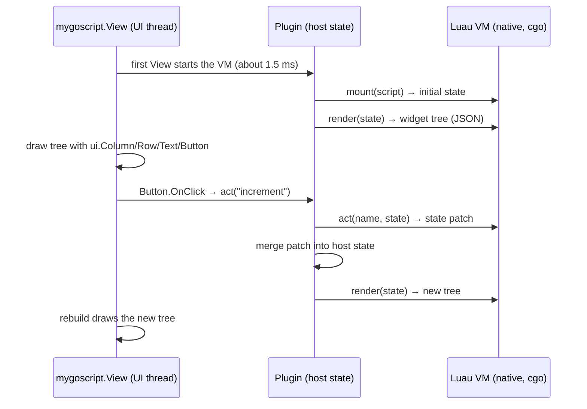

# mygoscript

`glitched/mygoscript` lets a Luau script describe native UI that the Go host
draws with MyGo's public `ui` package. This is a spike. It proves the loop
with one scripted counter on the Settings › Scripts page.



## Script describes, host draws

A script returns a table:

```lua
return {
	state = { count = 0 },
	view = function(state)
		return ui.column({ gap = 12 }, {
			ui.text("Count: " .. state.count, { size = 28 }),
			ui.button("Increment", { on = "increment" }),
		})
	end,
	actions = {
		increment = function(state) return { count = state.count + 1 } end,
	},
}
```

`view` is a pure function of state. It returns plain tables that `ui.*`
helpers build. The prelude (`prelude.luau`) checks the tree and encodes it as
JSON. Go decodes it and draws each node with the matching MyGo widget. The
script never holds a MyGo element, a `ui.Context` or a callback into Go.

## Host-owned, keyed state

The `Plugin` owns the state map. The script reads a frozen copy and returns
a patch from an action. The host merges the patch and renders again.
Consequences:

- A script error does not lose state. A restarted VM draws the same count.
- The script's `state` table only seeds keys the host does not have yet.
- State holds strings, finite numbers and booleans. Nested data is future
  work.

Widget identity is a key path. Each node uses its script `key`, or its kind
and index among siblings when it has none. A duplicate key falls back to
the index, with a suffix until it is unique. Strings must be valid UTF-8. The path goes through `c.Key` before each constructor, so a rerun
of `view` keeps MyGo's per-widget state (focus, hover, press) on the same
widgets.

## Why Luau, why not HTML

Luau is a small, fast Lua dialect built for sandboxed user scripts. It has
gradual types, a read-only global sandbox (`luaL_sandbox`) and an interrupt
hook for step limits. Scripts stay short, and an agent can write them well.

HTML would mean a web view per plugin. That brings a second layout engine,
a second theme and a second focus model, and it gives up the native widgets'
keyboard, accessibility and look. MyGo's `mygo.Plugin` / `mygo.Use` exposes
Go services to trusted web pages. That is the opposite trust direction, so
this package does not use it.

## A library on public `ui`, not a MyGo fork

The package imports only `github.com/egoist/mygo/ui`. It follows MyGo's
lifetime rules: no stored elements or Context, keyed identity through
`c.Key`, `OnClick` for actions. A build pass runs the script only once, at
the first `View`. After that it draws the cached tree, and only actions and
restarts run the script. MyGo upgrades stay ordinary
dependency bumps. All library code lives under `mygoscript/`. The app only
imports it (`scripts.go`).

## Embedding: official Luau, linked natively

`internal/luau` compiles the official Luau 0.745 compiler and VM into the
binary with cgo. A thin C++ shim (`shim.cpp`, `shim.h`) is the only code that
touches a `lua_State`. Go sees two calls: start a VM with the prelude, and
call a prelude function with a compiled chunk. Each call returns a string.

- `update.sh` vendors `Common`, `Ast`, `Bytecode`, `Compiler` and `VM` from a
  Luau release tag into `upstream/` (about 2.7 MB, with Luau's licenses).
  It writes one one-line `luau_<Dir>_<file>.cpp` wrapper per source file.
  cgo builds only C++ files in the package directory, and Luau's VM sources
  do not build as a single unit, because two files define the same static
  function.
- The flags are `-std=c++17 -O2 -DNDEBUG`. Luau's `LUAU_ASSERT` is live
  unless `NDEBUG` is set. In a measured 1e6-iteration loop, asserts cost
  about 25% (13 ms against 10 ms).
- Luau raises errors as C++ exceptions. Every Lua call in the shim runs under
  `lua_pcall`, and Luau never calls back into Go. The two `extern "C"` entry
  points also catch any exception that escapes, such as an allocation failure
  outside a pcall. They report it and the VM is closed, so no exception
  unwinds through Go frames.

### Build requirements

- cgo (`CGO_ENABLED=1`) and a C++17 compiler: GCC or Clang on Linux, Xcode's
  Clang on macOS. `CGO_ENABLED=0 go build .` now fails ("build constraints
  exclude all Go files" in `internal/luau`).
- A cold build compiles Luau in about 20 s. The Go build cache keeps the
  result, so later builds do not recompile it.
- Cross-compiling needs a C++ cross toolchain for the target.
- Run `go test ./...` with cgo on. A `CGO_ENABLED=0` run does not build the
  app package or `mygoscript`.
- CI (`.github/workflows/ci.yml`) installs `g++` on the runners. The `vet`,
  `test` and `race` jobs run with `CGO_ENABLED=1`, and `race` covers
  `./mygoscript/...`. A `nocgo` job vets every other package with
  `CGO_ENABLED=0`, so the engine and the CLI stay cgo-free.

### Why wasm was dropped

The first version of the spike ran Luau compiled to WASI wasm inside wazero.
That kept the build cgo-free and gave a hard memory sandbox. These scripts
drive the UI, though, and wasm slowed them down:

| measured on ferrum                  | wazero | native |
| ----------------------------------- | ------ | ------ |
| 1e6-iteration Luau loop             | ~60 ms | ~10 ms |
| first View (compile module + mount) | ~0.8 s | ~1.5 ms |

The wasm path also depended on wazero's experimental exception handling. It
is gone: no `luau.wasm`, no wazero dependency and no wasi-sdk build. The VM
now starts on the UI thread at the first `View`, with no placeholder frame.

### Sandbox

Luau's own hooks provide the sandbox. There is no process or wasm boundary.

- Libraries: base, table, string, math, utf8, bit32, buffer. There is no `os`,
  `io`, `debug`, `require` or `coroutine`. `print`, `getfenv`, `setfenv`,
  `loadstring`, `newproxy`, `gcinfo` and `collectgarbage` are removed. No
  remaining function reaches files, the network, the environment or
  processes. No grants exist in this spike.
- `luaL_sandbox` freezes the shared globals and the builtin metatables.
  Each call compiles its chunk in a fresh `luaL_sandboxthread`. A global
  that the script writes lands in the script's own environment, not in
  the shared globals. That environment lives as long as the VM, because
  the stored `view` and `actions` closures keep it. Restart clears it.
- The compiler allocates outside the Luau heap and has no interrupt, so
  sources over 256 KiB are refused before compiling.
- Limits per VM: a 32 MiB heap through a counting allocator. Limits per call:
  2,000,000 interrupt safepoints and 250 ms of wall-clock time. Both are
  checked in `lua_callbacks()->interrupt`. A spent budget stays spent, so
  `pcall` cannot swallow it. These errors are ordinary script errors, and
  the VM stays usable.

### Caveats

- Script calls run on the UI thread. A click (act plus render) measured about
  120 µs, and most of that is the forced full GC after each call.
- The time budget is checked only at safepoints. A single long C library call
  (a large `string.rep`, a pathological `string.find` pattern) runs to the
  end. The heap cap bounds how much data such a call can touch.
- The sandbox is in-process. A bug in the Luau VM is a bug in the app. wasm
  isolated that; native does not.
- Chunks are compiled for every call. They are tiny (a state literal), and
  the script compiles once per VM, so a bytecode cache does not help yet.
  Add one if large scripts or hot reload make compile time visible.

## Future

Not built in the spike:

- v1 widgets: column/row and text get styling props. Add button variants,
  text input, checkbox, slider and scroll/list. Inputs bind to host state
  keys so edits stay host-owned.
- File watch plus `Invalidate`: reload a script from disk on change, keep
  host state, and redraw with `c.Services().Invalidate`.
- Richer state (nested tables, lists) with a defined encoding.
- Extract `glitched/mygoscript` into its own repository once the API settles.
  The package has no imports from the app, so the move is a path change.
