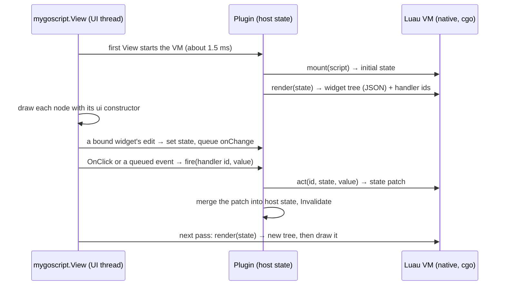

# mygoscript

`glitched/mygoscript` lets a Luau script describe native UI that the Go host
draws with MyGo's public `ui` package. Every `ui` widget that a sandboxed
script can drive is exposed. The Settings › Scripts page runs two scripts: a
counter (`scripts/counter.luau`) and a tour of the widgets
(`scripts/widgets.luau`).



## Script describes, host draws

A script returns a table:

```lua
return {
	state = { count = 0, name = "" },
	view = function(state)
		return ui.column({ gap = 12 }, {
			ui.text("Count: " .. state.count, { fontSize = 28 }),
			ui.button("Increment", { onClick = function(s) return { count = s.count + 1 } end }),
			ui.button("Reset", { onClick = "reset" }),
			ui.textInput({ bind = "name", placeholder = "Name" }),
		})
	end,
	actions = {
		reset = function() return { count = 0 } end,
	},
}
```

`view` is a pure function of state. It returns plain tables that the `ui.*`
constructors build. The prelude (`prelude.luau`) checks the tree and encodes
it as JSON. Go decodes it and draws each node with the matching MyGo widget
(`widgets.go`, `collections.go`). The script never holds a MyGo element, a
`ui.Context` or a Go value.

### The script API

Every widget has one constructor, `ui.<kind>(...)`. It takes these
arguments, in any order:

- A string or a number sets the kind's leading prop: a text's `text`, a
  button's `label`, a field's `label`, an icon's `svg`. The table below
  shows it in quotes, as `"label"`.
- A table of props. Its list items are children, and so is its `children`
  field.
- A widget, or a list of widgets, adds children.

A node is `{ kind, key, children, ...props }`. A prop holds a string, a
number, a boolean, a widget (a popover's `anchor`), a function (a handler),
or a list or table of these (a table's `rows`, a menu's `items`). The Go
registry is the one list of kinds: the host puts it in front of the prelude,
so `ui.<kind>` exists exactly for the kinds Go can draw. Any other name
raises a script error.

- **Element props.** Every widget takes MyGo's `Element` setters that have
  plain arguments: layout, flex, grid, text, color, border, effects and
  accessibility. Examples are `padding = { 8, 12 }`, `gap`, `width`,
  `grow`, `alignItems = "center"`, `columnTracks = { "1fr", "120" }`,
  `fontSize`, `bold`, `textColor = "#336699"`,
  `border = { width = 1, color = "#0002" }`, `shadow = {...}`, `radius`,
  `tooltip`, `label`, `placeholder`, `disabled` and `password`. `style.go`
  holds the full list. Colors are `#rgb`, `#rrggbb` or `#rrggbbaa`.
- **State styles.** `hovered`, `pressed`, `focused` and `highlighted` each
  hold a table of element props, which applies while the element is in that
  state. The `*Base` widgets need them to be styled from a script.
- **Events.** `onClick` and `onSubmit` work on any widget. `onChange` fires
  when a bound value changes. `onChoose` fires for a menu item, an alert
  button or a combobox option. The extra binds have `onChangeHigh`,
  `onOpenChange` and `onCurrentChange`. A handler is a function
  `(state, value) -> patch`, or the name of a function in `actions`.
- **Menus.** `menu` and `contextMenu` work on any widget, and `items` on
  `menuButton`. Each takes a list of entries:
  `{ label, checked, disabled, onChoose }`, `{ separator = true }`,
  `{ editItems = true }`, or `{ label, items }` for a submenu.

### Widgets

All 98 kinds, grouped. Each kind uses MyGo's `ui.<Kind>` constructor. A
widget marked "bind" edits a value. With `bind = "key"` the value lives in
host state. Without it, the host keeps the value per widget, and the
`value` prop seeds it.

| Group | Kinds | Props beyond element props |
| --- | --- | --- |
| Layout | `box`, `column`, `row`, `grid`, `scroll`, `scrollBoth`, `scrollHorizontal`, `spacer`, `divider`, `overlay` | children |
| Splits | `split`, `splitPercent`, `splitVertical`, `splitVerticalPercent` | bind (size); exactly 2 children |
| Text | `text` ("text"), `richText` (`spans`, text children), `link` ("label", `onClick`), `badge` ("text"), `icon` and `image` ("svg" markup), `avatar` ("name") | |
| Indicators | `spinner`, `progress` ("value"), `meter` ("value", `min`, `max`, `warning`, `critical`) | |
| Buttons | `button`, `primaryButton` ("label"), `buttonBase` (children), `menuButton` ("label", `items`) | |
| Text input | `textInput`, `textInputBase`, `textArea`, `textAreaBase`, `searchField`, `editableText`, `autocomplete` (`suggestions`), `textInputBuffer`, `textInputBufferBase`, `textAreaBuffer`, `textAreaBufferBase` | bind (string) |
| Tokens | `tokenField` (`suggestions`) | bind (list of strings) |
| Numbers | `slider`, `sliderBase`, `stepSlider`, `stepper`, `numberInput` (`min`, `max`, `step`); `rangeSlider` (`bind` and `bindHigh`); `rating` (`max`) | bind (number) |
| On or off | `checkbox` ("label"), `checkboxBase`, `checkboxGroup` ("label", children), `switch`, `switchBase`, `toggle` ("label"), `toggleBase`, `toggleGroup` | bind (boolean) |
| One of many | `radioGroup` with `radio` ("label", `value`) or `radioBase` children; `segmented` and `tabs` (`labels`); `segmentedBase` and `tabsBase` (a child per segment or tab); `select` and `combobox` (`options`); `selectBase` (`trigger`, `panel`, `option` children); `comboboxBase` (`panel`, `option` children, `onChoose`); `breadcrumbs` (`items`) | bind (string or index) |
| Color and date | `colorPicker` and `colorWell` (a hex string); `calendar`, `dateInput` and `timeInput` (`2006-01-02`, `15:04` or RFC 3339) | bind |
| Forms | `form`, `field` ("label"), `fieldset` ("legend") | children |
| Disclosure | `accordion`, `accordionItem` ("title"), `collapsible` ("label"), `collapsibleBase` (`trigger`), `tree`, `treeItem` ("label") | bind (open) |
| Overlays | `modal`, `dialogBase` (`backdrop`), `popover` and `popoverBase` (`anchor`), `tooltipBase` (`anchor`), `alertDialog` ("title", `message`, `buttons`, `onChoose`), `findBar` (bind the query; `bindOpen`, `matches`, `bindCurrent`) | bind (open) |
| Navigation | `toolbar`, `sidebar` (bind the chosen item's id), `sidebarSection` ("title", bind open), `sidebarItem` ("label", `id`, `icon` svg, children) | |
| Collections | `list` and `gridView` (`minWidth`, `itemHeight`), with a child per row or item; `table` (`columns`, `rows` of cells); `outline` and `outlineTable` (`items = { { id, label, row, cells, children } }`) | bind (selected index, -1 for none) |

`option` is the one kind that is not a MyGo constructor. It is an option of
`selectBase` or `comboboxBase`, drawn with `SelectParts.Item` or
`ComboboxParts.Item`.

### Not exposed, and why

| `ui` API | Why |
| --- | --- |
| `WebView` | A web view is out of scope for native script UI. It also needs a `NativeWebView` that the host creates. |
| `BackButton`, `ForwardButton` | They drive a `*ui.Router`. A plugin gets no handle on the app's navigation. |
| `ToastBase`, `ToastViewportBase` | They draw the window's toast queue, which the app owns. Showing a toast is an effect that a grant would add, not a widget. |
| `Textf` | It is `Text` with `fmt.Sprintf`. Scripts use `string.format` with `ui.text`. |
| `Link`'s `url`; `Image` and `Avatar` with a `*Bitmap` | Opening a URL launches the browser, and bitmaps come from files or the network. Both need grants that scripts do not have. `link` takes `onClick`. `image`, `icon` and `sidebarItem` take SVG markup. |
| Element methods that take Go callbacks | `Draw`, `DrawOver`, `HandleInput`, `HandleTextInput`, `Access`, drag and drop, `OnPaste`, `OnTextKey` and the animations (`Animate*`, `Spring`, `Keyframes`, `Timeline`, `Transition`) run Go code per frame or per event. The script runs only per render, so it cannot back them. |
| Sorting and multi-select in tables, lists and outlines | `ListState.Sort` and `Selection` need Go comparators and key sets. Tables, lists and grids bind one selected index. Outlines keep their open items in the host but expose no selection. |
| Menu item shortcuts, `OnShortcut` | Keyboard shortcuts reach outside the plugin's subtree. |

## Host-owned, keyed state

The `Plugin` owns all state. The script reads a frozen copy, and a handler
returns a patch that the host merges before it renders again.

- A widget with `bind = "key"` edits the state at that key. MyGo writes the
  edit into a Go value as the widget's constructor returns. The host stores
  the edit, renders the view again and runs `onChange(state, value)`.
- A widget without `bind` keeps its value in the host too, under its key
  path. Its `value` prop seeds it, and the value survives renders and VM
  restarts.
- Go-side widget state also lives in the plugin, by key path: a list's
  `ListState` (scroll and selection), an outline's open items, a text
  buffer, and parsed SVGs.
- A script error does not lose state. A restarted VM draws the same values.
- The script's `state` table only seeds keys the host does not have yet.
- State holds strings, finite numbers, booleans and lists of strings. Colors
  are hex strings, and dates are RFC 3339 strings.

Widget identity is a key path. Each node uses its script `key`, or its kind
and index among siblings when it has none. A duplicate key falls back to the
index, with a suffix until it is unique. The path goes through `c.Key`
before each constructor. A rerun of `view` therefore keeps MyGo's per-widget
state (focus, hover, press) and the host's values on the same widgets.

Handlers are Luau functions. The prelude registers each one under
`<render>:<n>` and puts that id in the tree. A handler's patch is merged at
once, but the view renders again only at the next pass. Every handler that
one input fires (a checkbox's `onChange` and `onClick`) therefore runs
against the same tree. An event from a tree that an older render drew is
dropped, so a handler never runs for the wrong node.

A checkbox group edits its checkboxes after they are built, so their edits
are stored once the group returns. Lists and grids give MyGo each row's
key path as its key, so a row keeps its focus and state when rows are
inserted before it.

### Errors in place

- A script error shows over the last good tree, with a Restart button.
  Script errors are syntax and runtime errors, a spent budget, a bad tree,
  an unknown `ui.<kind>` and a failing handler.
- A widget the host cannot draw shows its error in red where it would be,
  and the rest of the tree still draws. Examples are an unknown prop, a bad
  color, a radio outside a radio group, a split without two children and a
  `url`.

## Why Luau, why not HTML

Luau is a small, fast Lua dialect built for sandboxed user scripts. It has
gradual types, a read-only global sandbox (`luaL_sandbox`) and an interrupt
hook for step limits. Scripts stay short, and an agent can write them well.

HTML would mean a web view per plugin. That brings a second layout engine,
a second theme and a second focus model, and it gives up the native widgets'
keyboard, accessibility and look. MyGo's `mygo.Plugin` / `mygo.Use` exposes
Go services to trusted web pages. That is the opposite trust direction, so
this package does not use it.

## A library on public `ui`, not a MyGo fork

The package imports only `github.com/egoist/mygo/ui`. It follows MyGo's
lifetime rules: no stored elements or Context, keyed identity through
`c.Key`, `OnClick` and bound Go values for input. A build pass runs the script only at
the first `View`, or after a bound edit. Otherwise it draws the cached tree.
Handlers run after the pass is built. MyGo upgrades stay ordinary
dependency bumps. All library code lives under `mygoscript/`. The app only
imports it (`scripts.go`).

## Embedding: official Luau, linked natively

`internal/luau` compiles the official Luau 0.745 compiler and VM into the
binary with cgo. A thin C++ shim (`shim.cpp`, `shim.h`) is the only code that
touches a `lua_State`. Go sees two calls: start a VM with the prelude, and
call a prelude function with a compiled chunk. Each call returns a string.

- `update.sh` vendors `Common`, `Ast`, `Bytecode`, `Compiler` and `VM` from a
  Luau release tag into `upstream/` (about 2.7 MB, with Luau's licenses).
  It writes one one-line `luau_<Dir>_<file>.cpp` wrapper per source file.
  cgo builds only C++ files in the package directory, and Luau's VM sources
  do not build as a single unit, because two files define the same static
  function.
- The flags are `-std=c++17 -O2 -DNDEBUG`. Luau's `LUAU_ASSERT` is live
  unless `NDEBUG` is set. In a measured 1e6-iteration loop, asserts cost
  about 25% (13 ms against 10 ms).
- Luau raises errors as C++ exceptions. Every Lua call in the shim runs under
  `lua_pcall`, and Luau never calls back into Go. The two `extern "C"` entry
  points also catch any exception that escapes, such as an allocation failure
  outside a pcall. They report it and the VM is closed, so no exception
  unwinds through Go frames.

### Build requirements

- cgo (`CGO_ENABLED=1`) and a C++17 compiler: GCC or Clang on Linux, Xcode's
  Clang on macOS. `CGO_ENABLED=0 go build .` now fails ("build constraints
  exclude all Go files" in `internal/luau`).
- A cold build compiles Luau in about 20 s. The Go build cache keeps the
  result, so later builds do not recompile it.
- Cross-compiling needs a C++ cross toolchain for the target.
- Run `go test ./...` with cgo on. A `CGO_ENABLED=0` run does not build the
  app package or `mygoscript`.
- CI (`.github/workflows/ci.yml`) installs `g++` on the runners. The `vet`,
  `test` and `race` jobs run with `CGO_ENABLED=1`, and `race` covers
  `./mygoscript/...`. A `nocgo` job vets every other package with
  `CGO_ENABLED=0`, so the engine and the CLI stay cgo-free.

### Why wasm was dropped

The first version of the spike ran Luau compiled to WASI wasm inside wazero.
That kept the build cgo-free and gave a hard memory sandbox. These scripts
drive the UI, though, and wasm slowed them down:

| measured on ferrum                  | wazero | native |
| ----------------------------------- | ------ | ------ |
| 1e6-iteration Luau loop             | ~60 ms | ~10 ms |
| first View (compile module + mount) | ~0.8 s | ~1.5 ms |

The wasm path also depended on wazero's experimental exception handling. It
is gone: no `luau.wasm`, no wazero dependency and no wasi-sdk build. The VM
now starts on the UI thread at the first `View`, with no placeholder frame.

### Sandbox

Luau's own hooks provide the sandbox. There is no process or wasm boundary.

- Libraries: base, table, string, math, utf8, bit32, buffer. There is no `os`,
  `io`, `debug`, `require` or `coroutine`. `print`, `getfenv`, `setfenv`,
  `loadstring`, `newproxy`, `gcinfo` and `collectgarbage` are removed. No
  remaining function reaches files, the network, the environment or
  processes. No grants exist in this spike.
- `luaL_sandbox` freezes the shared globals and the builtin metatables.
  Each call compiles its chunk in a fresh `luaL_sandboxthread`. A global
  that the script writes lands in the script's own environment, not in
  the shared globals. That environment lives as long as the VM, because
  the stored `view` and `actions` closures keep it. Restart clears it.
- The compiler allocates outside the Luau heap and has no interrupt, so
  sources over 256 KiB are refused before compiling.
- Limits per VM: a 32 MiB heap through a counting allocator. Limits per call:
  2,000,000 interrupt safepoints and 250 ms of wall-clock time. Both are
  checked in `lua_callbacks()->interrupt`. A spent budget stays spent, so
  `pcall` cannot swallow it. These errors are ordinary script errors, and
  the VM stays usable.

### Caveats

- Script calls run on the UI thread. A click (act plus render) measured about
  120 µs, and most of that is the forced full GC after each call.
- The time budget is checked only at safepoints. A single long C library call
  (a large `string.rep`, a pathological `string.find` pattern) runs to the
  end. The heap cap bounds how much data such a call can touch.
- The sandbox is in-process. A bug in the Luau VM is a bug in the app. wasm
  isolated that; native does not.
- A bound edit renders the view again on the UI thread, so typing in a bound
  text input runs `view` once per keystroke. That is cheap for a form, but a
  heavy `view` would lag typing.
- Chunks are compiled for every call. They are tiny (a state literal), and
  the script compiles once per VM, so a bytecode cache does not help yet.
  Add one if large scripts or hot reload make compile time visible.

## Future

Not built yet:

- File watch plus `Invalidate`: reload a script from disk on change, keep
  host state, and redraw with `c.Services().Invalidate`.
- Grants for effects that a script may ask for (toasts, opening URLs,
  bitmaps), each off by default.
- Nested state (tables of tables) with a defined encoding.
- Extract `glitched/mygoscript` into its own repository once the API settles.
  The package has no imports from the app, so the move is a path change.
