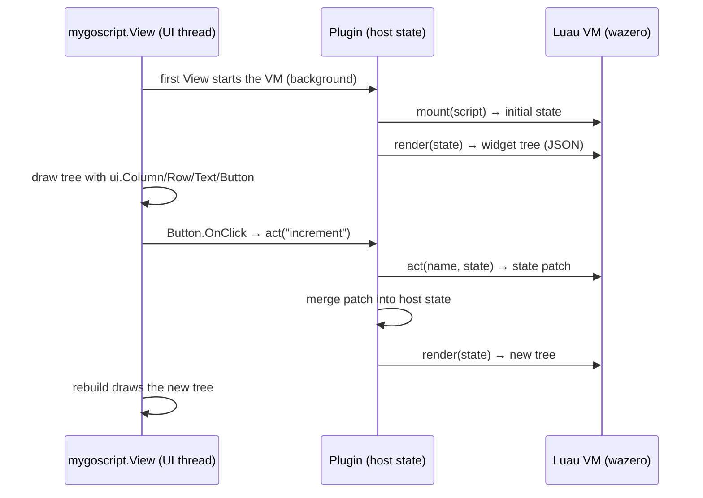

# mygoscript

`glitched/mygoscript` lets a Luau script describe native UI that the Go host
draws with MyGo's public `ui` package. This is a spike. It proves the loop
with one scripted counter on the Settings › Scripts page.



## Script describes, host draws

A script returns a table:

```lua
return {
	state = { count = 0 },
	view = function(state)
		return ui.column({ gap = 12 }, {
			ui.text("Count: " .. state.count, { size = 28 }),
			ui.button("Increment", { on = "increment" }),
		})
	end,
	actions = {
		increment = function(state) return { count = state.count + 1 } end,
	},
}
```

`view` is a pure function of state. It returns plain tables that `ui.*`
helpers build. The prelude (`prelude.luau`) checks the tree and encodes it as
JSON. Go decodes it and draws each node with the matching MyGo widget. The
script never holds a MyGo element, a `ui.Context` or a callback into Go.

## Host-owned, keyed state

The `Plugin` owns the state map. The script reads a frozen copy and returns
a patch from an action. The host merges the patch and renders again.
Consequences:

- A script error does not lose state. A restarted VM draws the same count.
- The script's `state` table only seeds keys the host does not have yet.
- State holds strings, finite numbers and booleans. Nested data is future
  work.

Widget identity is a key path. Each node uses its script `key`, or its kind
and index among siblings when it has none. A duplicate key falls back to
the index. The path goes through `c.Key` before each constructor, so a rerun
of `view` keeps MyGo's per-widget state (focus, hover, press) on the same
widgets.

## Why Luau, why not HTML

Luau is a small, fast Lua dialect built for sandboxed user scripts. It has
gradual types, a read-only global sandbox (`luaL_sandbox`) and an interrupt
hook for step limits. Scripts stay short, and an agent can write them well.

HTML would mean a web view per plugin. That brings a second layout engine,
a second theme and a second focus model, and it gives up the native widgets'
keyboard, accessibility and look. MyGo's `mygo.Plugin` / `mygo.Use` exposes
Go services to trusted web pages. That is the opposite trust direction, so
this package does not use it.

## A library on public `ui`, not a MyGo fork

The package imports only `github.com/egoist/mygo/ui`. It follows MyGo's
lifetime rules: no stored elements or Context, `c.Services()` for the
background redraw, `OnClick` for actions. MyGo upgrades stay ordinary
dependency bumps. All library code lives under `mygoscript/`. The app only
imports it (`scripts.go`).

## Embedding: real Luau on wazero

`internal/luau` runs Luau 0.745 (VM and compiler) compiled to WebAssembly.
wazero, a pure-Go runtime, runs it. The app stays cgo-free, and the same
binary works on every platform MyGo targets.

- `internal/luau/wasm/build.sh` downloads wasi-sdk 34 and the Luau tag. It
  builds `shim.cpp` and the Luau sources into `internal/luau/luau.wasm`
  (about 0.9 MB). The repo commits the output, so `go build` needs no C++
  toolchain.
- Luau raises errors with C++ exceptions. The build uses `-fwasm-exceptions`
  with the exnref encoding, and wazero runs it with
  `experimental.CoreFeaturesExceptionHandling` (new in wazero 1.12).

### Sandbox

- WASI module config with no preopened directories, no environment, no
  arguments and discarded stdout and stderr. No socket APIs are wired, so
  the script has no filesystem, network or process access.
- Libraries: base, table, string, math, utf8, bit32, buffer. There is no `os`,
  `io`, `debug`, `require` or `coroutine`. `getfenv`, `setfenv`,
  `loadstring`, `newproxy`, `gcinfo` and `collectgarbage` are removed.
  `luaL_sandbox` freezes the globals, and each call runs in a fresh
  `luaL_sandboxthread`.
- Limits: 2,000,000 interrupt safepoints per call, a 32 MiB Luau heap,
  64 MiB of wasm memory and a 2 s wall-clock timeout per call. A spent
  step budget stays spent, so `pcall` cannot swallow it. A trap or timeout
  closes the VM. The view shows the error and a Restart button.

### Caveats found in the spike

- Compiling the module takes about 0.8 s on first use, so the first `View`
  starts the VM off the UI thread and shows "Starting…". wazero's
  compilation cache could persist this across runs.
- Calls after startup run on the UI thread. They are sub-millisecond for
  the counter. The 2 s timeout is the worst case before the VM closes.
- `WithCloseOnContextDone` makes wasm loops check the context, at a large
  cost on long loops (measured: a 1e6-iteration Luau loop takes about 60 ms).
  That is fine for view code. Revisit it before heavy scripts.
- Wasm exception handling is experimental in wazero.

## Future

Not built in the spike:

- v1 widgets: column/row and text get styling props. Add button variants,
  text input, checkbox, slider and scroll/list. Inputs bind to host state
  keys so edits stay host-owned.
- File watch plus `Invalidate`: reload a script from disk on change, keep
  host state, and redraw with the captured `Services`.
- Richer state (nested tables, lists) with a defined encoding.
- Extract `glitched/mygoscript` into its own repository once the API settles.
  The package has no imports from the app, so the move is a path change.
